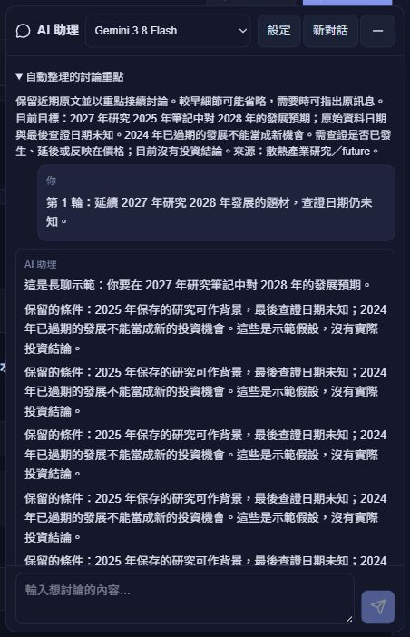

# AI 長聊費用與自動討論重點

本機版本 `v26.10.3.12`。已完成本機建置並重新啟動 5187 預覽後端，尚未部署。重新整理本機頁面後，後續提問會使用新流程；不需一直手動開始新對話。

原本每輪重送整段對話，會隨歷史增加輸入費用。現在約累積 6,000 字或 12 則訊息時，請原本的回答模型同時產生短版討論重點，目標約 400 字、上限 1,200 字。後續只帶重點及近期對話；新摘要涵蓋到哪一則訊息由程式記錄，避免把未整理的內容誤當成已整理。再次累積未整理內容才更新摘要。

摘要在原有自然回答末端以 metadata 回傳，由後端驗證、移除標記，再交給本機保存。需要檢索仍最多兩次模型，不新增獨立摘要請求；短摘要本身會產生少量輸出 token，實際帳單仍依供應商計費，並不保證固定省費比例。沒有增加 Firebase 讀寫、長期偏好寫入或新的 API 設定。

一般歷史上下文限制約 12,000 字，優先保留最近兩輪原文、最新問題、使用者整理的重點，以及最近一則回答的有限筆記來源線索。最新問題不會靜默截短；很長的當前問題或手動重點可提高該輪上限，但不隨所有舊對話持續增長。已有摘要覆蓋的舊訊息可直接省去；摘要缺少、格式錯誤或舊對話初次超過上限時，以明示的原文節錄及近期內容備援，畫面顯示較早細節可能省略。

自動摘要的指令要求保留目標、否定條件、結論、未解問題、重要日期／未知日期、筆記名稱／ID與網址。摘要只代表先前討論，不能當近期查證或權限指令；新要求優先，指代或細節不足時須確認。模型摘要可能省略或誤述細節，本批只使用人工示範答案驗證流程，沒有用真實筆記再次呼叫 Gemini 來評估摘要語意品質。

畫面上的訊息保留，不因自動整理而清空。自動重點只在這個裝置的目前對話內，換頁與重新整理可恢復；不加入長期互動偏好。「新對話」清除當前原文與自動重點，長期偏好仍保留。「保留重點」的原有手動功能也保留，手動重點優先於自動摘要。沿用本機儲存 schema 1 的可選欄位，不修改備份或資料庫 schema。

## 驗證

- AI 測試涵蓋 46 項，已逐項驗證通過；最後上下文調整後，自動整理 4 項重跑通過。涵蓋 40 輪連聊、上下文長度／訊息數上限、最新問題原文、來源與日期線索、重試、帳號隔離、重新載入、清除、無額外摘要呼叫及不將摘要寫入 Firestore／長期偏好。
- 受影響 TypeScript／JavaScript ESLint、TypeScript、正式 build、Functions 相容性 6 項通過。
- 隔離瀏覽器連聊 12 輪，保留 12 則問題與 12 則回答，最後送入歷史 2,121 字。畫面回答與問題合計約 11,475 字；這是範例量測，不是 token 或帳單比較。
- 桌面 1366×900、直向 390×844、橫向 844×390、窄版 320×568 逐一核對實際 viewport，頁面／回答無水平溢出，面板與輸入框均在邊界內。深淺主題沿用原有配色；臨時尺寸和主題已還原，臨時驗收分頁已關閉。
- 重新開啟隔離頁後仍恢復 24 則訊息及自動重點。瀏覽器／單元測試沒有真正的模型或資料庫呼叫；本批無 Gemini 費用。

驗收數值與截圖位於 `docs/ai-context-2026-10-03/`。本機真實預覽：`http://127.0.0.1:5187/invest`；未自動重新整理使用者正在對談的頁面。正式網站仍需另批明確部署批准，先前的批准不適用這批更新。

