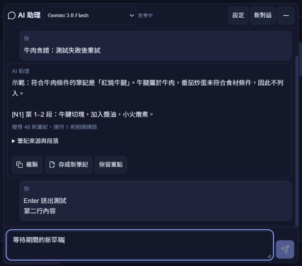

# AI 對話 Enter 送出

版本：`v26.10.3.10`，本機修正與建置完成，尚未部署。這是需求理解 `.9` 完成後的新一批介面修正；正式網站仍為 `.8`。

原本輸入框只有 Ctrl／⌘＋Enter 送出，單按 Enter 採 textarea 的預設換行。改為 Enter 送出、Shift＋Enter 換行；原 Ctrl／⌘＋Enter 仍可送出。鍵盤透過同一個表單送出流程，維持模型可用、內容非空、等待時停用及送出後立即清空等條件。

中文等輸入法選字期間，`isComposing` 或相容事件碼 229 不會送出或攔截選字；長按 Enter 的 repeat 事件不會發出新請求。等待回覆時按 Enter 不會重複送出或清掉後續草稿。僅 AI 對話輸入框套用此快捷鍵，偏好與筆記編輯仍可直接換行。

驗證：鍵盤回歸測試與送出／手動重試相依測試共 3 項通過；TypeScript、正式 build、建置前 Functions 相容性 6 項及受影響前端 ESLint 通過。本批沒有重跑真實模型／私人筆記測試，沒有新增 Firebase 或 Gemini 用量。

隔離瀏覽器在示範頁實測 Shift＋Enter 保留兩行、Enter 顯示一次問題並清空輸入框、等待時保留新草稿不重複送出，完成後新草稿仍存在。示範使用固定回覆，不連 Google／Firebase。正式本機預覽 `http://127.0.0.1:5187/invest` 已由更新後的 `dist` 提供，重新整理可載入新版。

