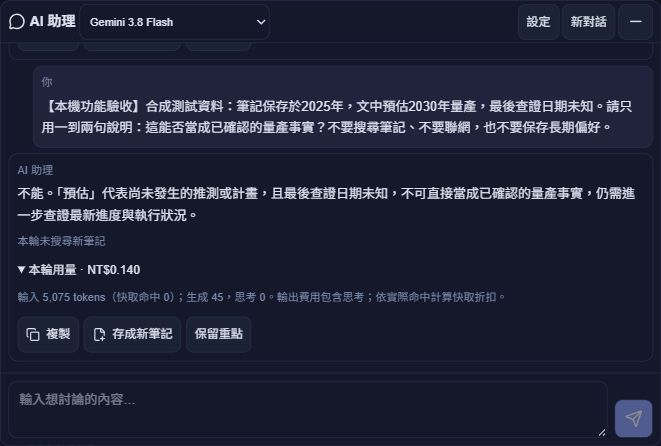

# AI 真實模型驗收 — v26.10.4.4

本批接續模型狀態修復，完成 Gemini 的真實生成驗收。僅更新本機，未部署或修改 Netlify／Firebase 正式設定。沿用使用者核准的 Google 帳號 `summer94232@gmail.com`、專案 `gen-lang-client-0155504975` 與原金鑰；沒有新增帳號或其他供應商。

## 本次補強

真實長文驗收發現：原文只說「預估時程延後至 2030 年，仍待客戶驗證」，模型曾摘要成「已正式延後」。摘要與最終回答的規則均已補強，要求保留「預估／可能／待驗證」的確定程度，區分筆記記載與本輪已查證事實。

閱讀摘要版本同步更新；舊規則產生的摘要不再當成有效快取。下次需要閱讀時才重新整理，原始筆記不變，也不自動重讀整個資料庫。這能減少把假設說成事實的風險，不能保證模型永遠不誤讀。

新增 `scripts/verify-ai-live.mjs`，以明確的 `--generate` 選項啟用付費驗收。腳本核對帳號、專案、金鑰指紋與 NT$150 月上限，沿用真正的交易式費用預留／結算、速率限制，另以本次驗收累計 NT$3 限額防止重跑失控。紀錄只輸出合成內容與用量，不輸出金鑰、UID 或摘要簽章。

## 已驗證的範圍

| 項目 | 實際結果 |
|---|---|
| Gemini 3.8 Flash、3.5 Flash-Lite | 兩個模型均有成功的真實生成與用量結算。GPT／Claude 仍依原設定停用。 |
| 自然語句理解與檢索 | 用「半小時內、不辣、牛肉料理，排除雞肉與投資研究」測試，回答選出 15 分鐘的蔥炒牛肉。候選檢索仍可能包含雜訊，由模型再判斷條件；此案例通過不代表所有需求都能精準命中。 |
| 接續對話與自動重點 | 使用前端實際的對話組裝函式，追問能沿用食材／時間條件，產生短版討論重點，不新增筆記或長期偏好。 |
| 筆記 AI 標籤與建議連結 | 實際編譯前端工具，呼叫真實模型後解析標籤與有效候選 ID；驗收不儲存到使用者筆記。 |
| 長文分批閱讀 | 20,780 字合成文章，分為 8 段，以兩批讀完；最後回答保留文末推翻 2028 年假設的反證代碼「紅橋-73」，並標明 2030 年仍屬預估、待客戶驗證。 |
| 摘要重用 | 後續整理重用全部 8 段有效摘要，只呼叫一次綜合回答，沒有再次呼叫分段摘要。這是本系統摘要快取，不等同 Google 輸入 token 快取命中。 |
| 真實登入與網頁送出 | 在本機正式建置頁面，使用已登入帳號按 Enter 送出；輸入框立即清空、出現使用者訊息與等待狀態，取得 Gemini 回覆和用量。縮小／重開仍保留本輪對話。 |

CLI 驗收使用合成筆記與偏好資料，模型 API 與共用預算帳務是真實服務；直接呼叫後端處理函式時使用測試登入接點，所以不將 CLI 當成 HTTP 登入驗證。最後網頁測試則經過實際 Firebase 登入與本機 HTTP 後端，沿用瀏覽器目前的對話內容，沒有新增筆記搜尋、聯網或儲存偏好。

網頁測試問題是合成情境：「2025 年保存的筆記預估 2030 年量產，最後查證日期未知，能否視為已確認？」實際回答：

> 不能。「預估」代表尚未發生的推測或計畫，且最後查證日期未知，不可直接當成已確認的量產事實，仍需進一步查證最新進度與執行狀況。

重新整理後，對話與費用仍保留；模型設定成功載入。截圖只包含 AI 對話區：

## 驗收成本與檢查

- CLI 真實生成累計估算 **NT$1.712**；網頁一輪 **NT$0.140**，本批合計 **NT$1.852**，已納入系統共用帳務。
- 網頁回報輸入 5,075 tokens、生成 45、思考 0、快取命中 0。輸入包含系統規則與既有對話，不能只用本輪問題字數估價。
- 成功驗收沒有未結算預留；失敗／逾時仍沿用保守預留、不自動重試的原規則。
- 72 項 AI 測試通過，包含舊摘要失效、簽章與原筆記不受影響的新測試。TypeScript、受影響檔案 ESLint 與正式 Vite 建置通過；仍有既有大型分包提示。
- 兩個 Gemini 的真實 `countTokens` 計數也通過；這項檢查沒有生成回答或讀取私人筆記。
- 安全驗收報告位於 `log/ai-live-2026-10-04-*.json`，分別記錄 09:25:17、09:29:56、09:31:13、09:31:16 UTC 的驗收。第一份揭露的措辭問題已於後續長文／重用驗收修正。網頁紀錄為 `log/ai-live-browser-2026-10-04.json`。

## 現在的能力與使用方式

目前是具備對話理解、個人文字資料檢索、長文分批整理、來源回查、對話重點與長期偏好的個人知識／研究助理。可正常描述需求與限制，同主題繼續聊；不必為了省錢每次都開新對話。跨主題或討論結束時再新開，重要結論自行確認後存成筆記。

- 一般回答先取相關摘錄；要跨長篇比對時使用「完整整理」，並留意實際閱讀範圍、未讀段落與剩餘預算。
- 保留每月 NT$150、每日 NT$10、一般一輪 NT$1、同項完整研究 NT$5 的系統估算上限。這不是整個 Google 帳號帳單鎖，其他程式、稅額與匯率差異不在其中。
- 維持模型理解需求後的文字檢索，尚未加入向量索引；不保證找齊所有相關資料。長文摘要亦可能省略細節。
- 預算模式停用自動聯網，不會自動確認最新投資現況。來源日期或最後查證日期未知時，應回查原文並補充新證據。
- 目前主要讀取已保存的文字；不自動讀取外部網址全文、圖片、掃描 PDF 或附件。這些是尚未新增的能力，不是本次遺漏的修復。

本機預覽：<http://127.0.0.1:5187/invest>。正式網站仍須在完成本批後取得新的部署批准才會更新。
