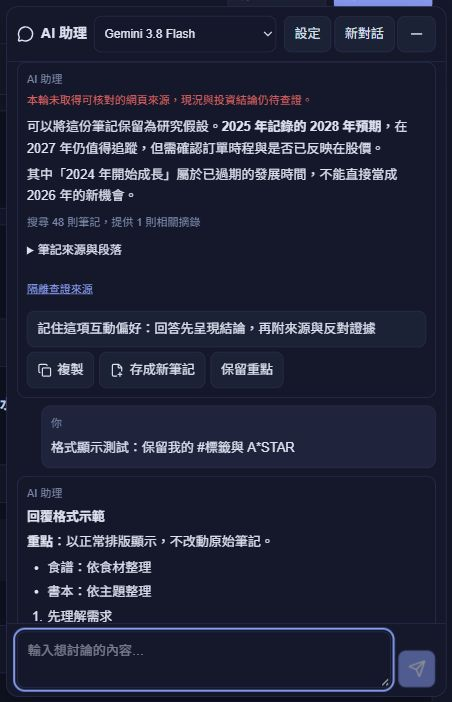

# AI 回覆排版顯示

版本 `v26.10.3.11`，本機修正及建置完成，尚未部署。正式網站仍為 `.8`；這是 `.10` Enter 送出修正完成後的新一批顯示改善。

原本只處理粗體與連結，因此 `####`、條列星號、表格分隔字元會直接出現在答案。現在以 Markdown 元件解析 AI 回覆，將標題、段落、粗斜體、清單、引用、程式文字與表格顯示為正常排版；既有回覆重新載入後亦適用。使用者訊息與原始筆記摘錄保留原文。

複製、存成新筆記草稿及保留討論重點使用畫面上的可讀文字，來源網址以普通文字附在內容末端並去除重複網址；來源編號、`A*STAR`、`#標籤`、算式及程式內容的字面符號保留。原始對話內容仍保留，不改寫已有笔記；只有使用者確認儲存才建立新筆記。新筆記標題不再全域移除 `#` 和 `*`，避免破壞名稱中的有意義字元。

元件使用 [react-markdown](https://github.com/remarkjs/react-markdown) 與 [remark-gfm](https://github.com/remarkjs/remark-gfm)，記錄於 npm manifest／lock。採可允許元素清單、忽略 raw HTML，不載入答案中的圖片或任意 HTML；連結只接受 HTTP(S)。核對清單為停用的唯讀顯示，表格可於自身容器橫向捲動。沿用原有主題變數，不加入新配色。Markdown 元件 memo 避免草稿每次輸入都重新解析既有答案；依舊在 AI 面板延遲載入。

本批未修改模型指令、供應商、帳號、檢索規則或配額。沒有新的 Gemini、Firebase 實測呼叫，沒有部署。

## 驗證

- 重點測試 3 項通過：Markdown 顯示／字面符號與不執行内容、複製／草稿／摘要保留乾淨文字及來源且不改原回覆、Enter／Shift＋Enter／IME／等待時送出相依行為。
- TypeScript、正式 build、建置前 Functions 相容性 6 項及受影響元件 ESLint 通過。最後來源網址保留修正已重跑其專屬測試與 build。
- 隔離示範頁顯示四階標題、粗體、兩種清單、表格、引用及連結；實際複製與新筆記草稿無排版標記，保留字面符號、來源編號及來源網址。草稿取消，未確認儲存。
- 桌面 1366×900、直向 390×844、橫向 844×390、窄版 320×568 均無頁面／答案水平溢出，AI 面板與右上角動作在邊界內。淺色與深色截圖已檢查，臨時 viewport／主題／測試模式已恢復。
- 瀏覽器使用固定示範答案與資料，0 模型呼叫、0 資料庫呼叫。數值收據與截圖在 `docs/ai-markdown-2026-10-03/`。

本機正式預覽仍為 `http://127.0.0.1:5187/invest`，重新整理可取得新建置；未自動重新整理使用者正在對談的頁面。

