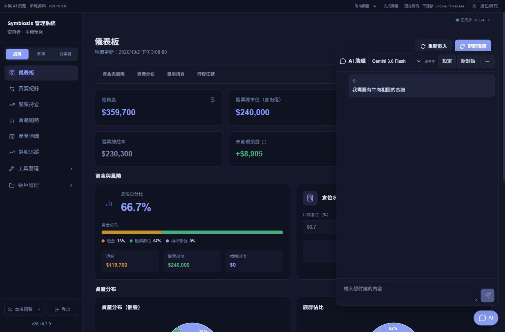
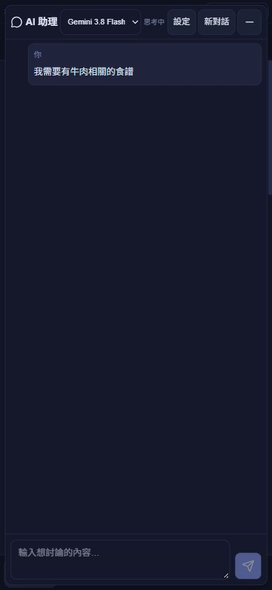

# AI 需求理解、限額檢索與送出狀態修正

版本：`v26.10.3.9`。同一批持續修正，尚未部署；正式站仍為 `.8`，先前批准不涵蓋這一批。

使用者要的是理解完整需求與上下文，再決定怎麼找資料，不是只讓固定詞匹配更準。本批將 chat 改為「模型先讀目前對話 → 需要時提出一次受限工具呼叫 → 系統驗證與執行檢索 → 模型核對完整條件後自然回答」。沒有固定題材的回答模板。

## 對談與需求理解

- 一般聊天或既有摘錄足夠：直接回答，一次模型回合，不查 KMS 或投資資料。指涉不清時先追問，不猜是哪個題材或哪本書。
- 需要新資料：整理承接前文後的完整需求，產生核心概念、同義詞及範圍內常見名稱。概念之間可一起匹配，明確的比較或替代需求可分別匹配。
- 「半小時內」「不要辣」「更省事」等條件保留在完整需求，相關線索用於排序及挑選段落，不要求每個形容詞都逐字出現。取得資料後仍要核對條件，無法確認就明說。
- 依語意判斷現況查證；「現在想找以前記過的食譜／書本」不因「現在」字眼聯網。聯網遵守既有開關。
- 本機目前對話與近期摘錄仍可換頁、縮小後繼續，不將對話寫入 Firestore；長期偏好沿用明確要求／候選確認機制。

工具 schema 每组使用 `{ terms: [...] }`，避免省成本模型將巢狀陣列多包一層。驗證工具名稱、欄位、類型、上限，拒絕額外 UID、寫入命令、錯誤或過大計畫；錯誤不自動重試、不增加第二次檢索。

第一回合僅提供需求工具，第二回合將驗證過的需求和實際資料放入獨立回答請求，不傳供應商思考內容或維持原生工具延續鏈。三家介面已有工具格式與解析，本次啟用與實測仍只用原 Google 帳號的兩個 Gemini 模型。官方能力說明：[Gemini Function calling](https://ai.google.dev/gemini-api/docs/function-calling)。

## 檢索與日期

沿用壓縮文字索引，每次最多 32 頁、6 則原筆記；再核對現存摘要與內文，排除刪除、圖片及過期索引命中。手動搜尋詞是額外範圍，不能覆蓋完整需求。投資資料只讀一組：最多 20 筆交易，或 20 筆選股加 20 筆觀點，不代表完整帳戶。

模型產生動態別稱與相關名稱，不逐類新增字典。候選仍依文字檢索；含同一字但語意不同或相反的內容可能進入候選，回答回合須排除不符合完整需求的內容。來源列如實保留實際提供的候選，不把候選數宣稱為完全符合數。這不是向量搜尋，隱含關係及少見用語仍可能漏查。

摘錄優先保留核心與條件相關段落，再加入鄰近上下文；每則最多 2,600 字並附現有標籤。日期逐段／逐主張評估，建立與修改日期不是原始來源、預期發展或最後查證日期。生活筆記不套投資期限；當前機會仍需近期證據，無依據的時間保持未知。

## 用量保護

一般聊天一次模型回合，需要新資料時最多兩次，仍用本輪選定的同一模型。先預留兩回合保守費用上限，最後合計實際輸入、輸出、思考、搜尋費用一次結算。理解已完成但檢索失敗，只結算已知完成的費用；超時或用量不明，保留未核對額度。

初始 chat 保守配置 8 次投資資料庫讀取、4 次寫入，涵蓋用量帳本與可能的明確偏好更新。理解後，原請求原帳號原子增加必要檢索配置，不占第二個速率名額。KMS 上限仍 45 讀取、0 寫入；投資依計畫加 20 或 40 讀取。配額先通過才讀資料，不自動擴大範圍或反覆搜尋。

## 訊息送出

問題立即進入對話、清空輸入框並顯示思考中。完成不清除等待時的新草稿。失敗保留原問題與手動重試，重試不新增重複訊息、不消耗新草稿。新對話、切換帳號與延遲回覆隔離保留。

## 驗證

- AI 自動測試 39 項通過，涵蓋理解先於檢索、一般聊天不查資料、跨句條件、不同筆記種類、工具驗證、配額與跨日配置、兩回合費用及失敗保留。
- 正式 build（含 TypeScript）、Functions 相容性 6 項及受影響前端 ESLint 通過。前批索引相依 5 項通過，本次未改索引 schema。
- 真實模型測試程式 `scripts/check-ai-intent.mjs` 只使用明列的人工食譜、產業、書本範例與記憶體資料庫，不連 Firebase、不讀私人筆記／偏好／帳務。需加 `--generate` 才會產生費用，可用 `--main-only` 或 `--reading-only` 聚焦測試；費用存驗證收據，未寫入正式用量帳本。
- Flash-Lite 已通過書本需求理解與兩回合回答，未把「現在」視為需要聯網。主模型一般聊天 1 回合，間接餐點需求 2 回合，承接半小時限制 1 回合沿用摘錄；正確列出兩篇牛肉料理，排除非食譜，追問依明確的 15 分鐘／2 小時資訊只推薦快炒。兩個模型沿用核對過的同一 Google 金鑰。
- 主模型最終測試原先以「答案完全不出現不相關題名」為判斷，將「故予以排除」的說明誤判成推薦；已改成檢查推薦清單，使用該次人工資料的原始輸出重新核對，沒有再耗費模型呼叫。收據保留原判斷與更正原因。
- 使用者於本輪明確批准傳送實際檢索的筆記摘錄後，已完成認證過的 localhost 真實資料整合。未在先前審查拒絕時執行該測試；本次沿用指定 Google 帳號、專案及金鑰，每輪最多 6 則摘錄，聯網停用，未部署。
- 真實整合包含帳號核對、一般對談、未直接使用「食譜」字眼的餐點需求、追問半小時條件、Flash-Lite 書本需求。一般對談 1 回合且不查 KMS；餐點需求 2 回合，106 則索引中提供 1 則，答案所引來源存在且摘錄／標題包含核心食材；追問 2 回合並保留牛肉主題；書本需求 2 回合，未取得符合的摘錄，不觸發現況聯網。
- 以上真實模型呼叫共 7 次，已按回傳用量完成結算，估算 NT$0.29；0 筆記寫入、0 偏好寫入，仅既有用量帳本更新。收據 `log/ai-intent-local-2026-10-03.json` 只保存數量、布林與費用，不保存筆記、答案、UID 或憑證。106 是索引筆記掃描數，不代表 106 次 Firestore 讀取。
- 前批另外的唯讀 KMS 檢索曾確認 106 則索引，匹配與提供 2 則，每次成功檢查 21 讀取、0 寫入、0 模型呼叫；不同條件與動態概念可能取得不同候選，這項歷史檢查與上述真實整合分開記錄。
- 示範瀏覽器已驗證清空、等待草稿、縮小重開、失敗重試不重複，桌面、手機直向／橫向／窄版無水平溢出。畫面為示範資料與固定回覆，真實模型另外實測。

## 後續部署

等使用者明確批准這個完成批次才部署。沿用原 Google 帳號與金鑰。上次 16 個 AI 變數為部署層 Functions-only overrides，未持久写入網站變數；下次必須重新帶入，敏感值使用 `--secret-env`。不能重跑上次僅允許一次且基準為 `.8` 的部署腳本，或將密鑰擴大到 build scopes。

