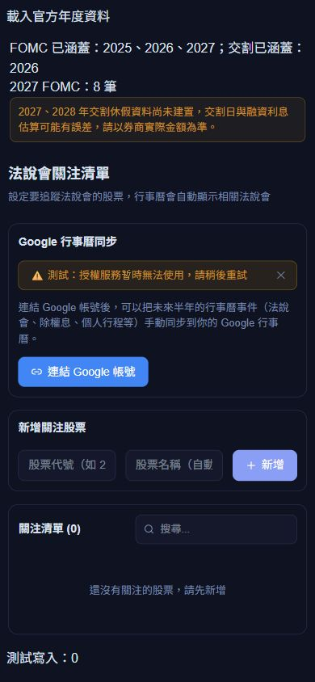
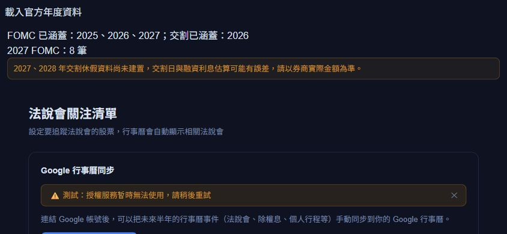

# 年度自動更新與 Google 連結安全 — 2026-09-30

本機版本 `v26.9.30.6`。本批完成程式及本機驗證；未正式部署、未觸發正式排程，未修改正式設定或登入／讀取私人平台內容。沿用既有 Netlify／Firebase 與機密設定，不新增平台、金鑰、Google scope 或 IAM 權限。

## 年度日程

- `annual-calendars-refresh` 是 Netlify 原生排程函式，UTC 每週日 00:00（台灣 08:00）執行。查上一年、當年及下一年；全年檢查涵蓋年末公布及官方後續改期。公開資料寫入 `sharedData/annualCalendars`，與個人財務資料分開。
- FOMC 按官方 HTML 的年度區塊、月份與會議最後一天解析，排除明確標記的 notation vote；只接受八筆完整日期。初始資料含已核實 2025–2027 日程，並修正舊版 2025-12-17 → 2025-12-10、2026-12-16 → 2026-12-09。官方預定日程可能調整。
- 證交所必須使用 `date=YYYY0101`，不是 `queryYear`；後者可能默默回傳當年資料。2027 正確查詢目前回傳空資料，所以不聲稱已建置。檢查 `queryYear`、ROC 年度標題、筆數、日期與說明；排除週末、開始／最後交易日及仍辦理交割的無交易日。2026 共 16 個平日交割休假，02-12、02-13 仍辦理交割，不列入。
- 官方來源失敗、未公布、格式變動或不完整時，該資料不覆蓋前次日程。有效年份獨立合併；交易防止較舊的重疊執行覆蓋較新結果。全部失敗時零寫入。
- 同一登入的各頁在日期載入後才掛載，故交割利息、缺年提示、月曆與 Google 同步使用同一份日程。瀏覽器只快取白名單化公開日程欄位，離線重新載入保留已核實日期；未涵蓋年份保留提醒。已開頁面重新整理後套用最新排程結果。
- 正式部署前排程不執行。首次部署時確認 Scheduled 標記／下次執行時間，可用 Netlify Run now 驗證。前端與後端一起發布；讀取端有官方初始日程，第一次排程前即可取得 2027 FOMC。
- 每週資料檢查不等於天然災害臨時休市即時監控；保留券商實際交割與人工金額核對。沿用既有平台額度，無升級方案，不保證超額免費。

## Google 安全與相容性

- 啟動授權改為帶 Firebase ID token 的 POST。沿用既有專案／白名單／撤銷驗證及用量檢查。
- OAuth state 用 AES-256-GCM 加密並驗證，使用現有伺服器 Google secret 派生用途專用金鑰；隨機 IV，綁定 UID、Firebase auth_time、分頁亂數及 10 分鐘期限。Google 的授權網址不暴露 UID 或登入時間。
- 使用 `__Host-` HttpOnly、Secure、SameSite=Lax cookie，Google 回傳 state 必須與原 cookie 相符。每人一筆私有待授權紀錄，交易將雜湊原子改為 consumed 後才交換 code，防重播／被較新授權取代；用 create/update 權限即可，不需 delete 或 TTL 設定。
- 前端清除 fragment，核對目前 UID、登入時間、原分頁亂數與期限，保存前再核對兩個 Firebase session，拒絕舊版未綁定回傳。有效既有授權無需重連；拒絕重新授權時仍載入原有效連結，既有 calendarId 和 syncTypes 保留。
- ensure、pull、sync、series 比對目前 UID 私有設定內的 refreshToken／calendarId，不接受另一帳號或任意行事曆。保留既有端點 payload，相容已儲存資料；前端新增 Authorization，與後端須同批部署。舊開頁需重新整理。
- 系統生成的全天 FOMC 事件改期時，下一次手動同步以原 Google event ID、etag／If-Match 更新日期，不新增重複事件；手動、定時、重複與無版本事件不被此規則覆蓋。
- 不返回 access token、不將原始 OAuth provider／SDK error 放入網址或日誌。refreshToken 仍沿用本人 Firestore 設定與備份；後端 token vault 不在本批範圍，備份仍應保管。

## 驗證

- 完整 `npm test` 648／648，posttest 函式 runtime 6／6。最後修補「重新授權被拒絕仍顯示有效舊連結」後，新功能聚焦測試 54／54；build、零警告 lint 再次通過。已有大型 chunk 提示仍存在。
- 公開官方來源直接查詢及實際 HTML／JSON fixtures：八次 FOMC、notation vote、跨月、缺年／空清單、錯年、非法日期／重複／不完整、交割專用日、全部來源失敗、較舊重疊執行、台灣跨年、離線快取與啟動帳號切換。
- OAuth 正常流程、加密／竄改／缺 cookie／過期／重播／被取代、前端換帳號／同 UID 重登入／等待中 session 改變、舊 fragment、保留連結、跨帳號 token／calendarId、Firebase 憑證 header、未授權零 Google 呼叫及改期 If-Match。
- 648 全套涵蓋原有 Google 刪除、雙向同步、重複系列及共用驗證；最後 UI 使用真實 CalendarSettings 和隔離記憶體服務，390×844、844×390 無水平溢出。讀取 2027 FOMC 八筆、保留缺交割年提示、授權服務失敗後重試可用，零測試寫入。
- 最終前端 90 個 HTML／CSS／JS 檔案掃描：私鑰標記、API_FIREBASE_SERVICE_ACCOUNT、GOOGLE_CLIENT_SECRET 均 0。沒有讀取或輸出實際憑證、UID、Google 行程或私人財務資料。

## 官方來源

- [聯準會 FOMC](https://www.federalreserve.gov/monetarypolicy/fomccalendars.htm)
- [證交所年度日程](https://www.twse.com.tw/rwd/zh/holidaySchedule/holidaySchedule?response=json&date=20260101)
- [Google OAuth state 指引](https://developers.google.com/identity/protocols/oauth2/web-server)
- [Netlify 排程函式](https://docs.netlify.com/build/functions/scheduled-functions/)

2026-09-30 使用者另行明確批准正式部署與排程啟用，已完成正式排程註冊、Run now 首次寫入與公開日程文件回讀驗證；詳見 [正式發布紀錄](RELEASE_2026-09-30.md)。實際 Google OAuth／有效舊連結同步與手機 cookie 導回尚未做正式環境驗收，本次未讀取私人 Google 日程。
