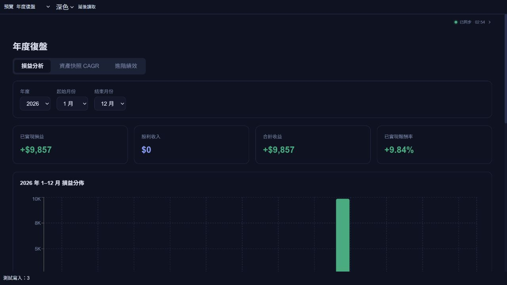

# 八項修正的回歸複查報告

日期：2026-10-05（Asia/Taipei）  
本機版本：`v26.10.5.1`  
範圍：複查 [10/04 修正報告](AUDIT_FIXES_2026-10-04.md) 的 R01–R08，以及受影響的帳本寫入、持倉、年度報表與表單。已完成本機補修和驗證，尚未部署；未讀取或修改正式私人帳務。

## 複查結論

前次修正仍有 **5 個可重現的帳務／績效問題**，已在本批補修。其中融資配股的多批次成本，以及舊紀錄修復被阻擋，直接影響前次新增流程，不能只依原本測試通過就認定安全。另有一處缺少備註的舊股利紀錄會觸發 React 表單警告，也已處理。

最初重跑相關測試 112 項全部通過，但新增的 5 個重現案例全部失敗；補修後這些案例及後續擴充測試通過。保留 [修正前失敗紀錄](audit-recheck-2026-10-05/before-fixes.log) 和 [修正後 24 項專項結果](audit-recheck-2026-10-05/regression.log)，可直接比較，沒有刪掉失敗案例來取得通過結果。

## 五個問題與補修結果

| 項目 | 修正前的問題與影響 | 本批修正與驗證 |
|---|---|---|
| 1. 融資配股的成本批次與負債批次不同步（R06） | 借款帳把配股加回原買入批次，持倉帳卻新增另一批配股；多次買入後部分賣出，成本和償還本金會扣到不同批次。重現案例中賣出 550 股的成本為 49,999 元，正確應為 50,000 元 | 融資配股擴充原 FIFO 批次，保留買入 ID／日期，並保留完整成本。兩批成本 100,000／200,000 元、各 1,000 股，共配 200 股：賣出 1,100 股時成本為 100,000 元、償還本金 60,000 元；另驗證 550／1,650 股與剩餘庫存、負債 |
| 2. 舊配股分類錯誤反而阻擋修復（R06） | 舊帳有依賴未分類配股的賣出，後面又有其他交易時，寫入前檢查先對舊帳拋錯，導致填入正確分類也無法儲存 | 只在庫存預檢重播時容許略過既有不匹配賣出，讓檢查能比較修正前後缺口。實際損益／淨資產計算仍保持原有嚴格檢查。真實 Firestore emulator 交易證實：補填 100 股可成功；再改成 50 股、造成新的 50 股缺口時會拒絕，已存資料及帳本版本不被改壞 |
| 3. 全損區間漏顯示最大回撤（R04） | 合法的 -100% 報酬附有邊界說明，畫面把這個說明當成資料錯誤，將應為 100% 的最大回撤顯示為缺值 | 回撤獨立依收盤端點與淨值曲線有效性判斷；合法全損顯示 100%，缺收盤資料仍不補造數字 |
| 4. 未來快照被當成目前淨值（R03／R07） | 進階績效直接取最後一筆快照；若保存了未來日期，會被當成目前期末淨值 | 年度主載入及進階載入都排除今日之後的快照，進階計算依日期排序。以 2025 年 100,000 元、2026 年 120,000 元及未來 999,999 元驗證，截至 2026-10-05 仍為正確的 20% 年化報酬 |
| 5. 重複期末快照仍算出看似有效的 XIRR（R03／R07） | 淨值曲線已拒絕重複日期，全期間 XIRR 卻任取最後一筆，導致同頁資料品質規則不一致 | 全期間 XIRR 同樣拒絕重複的期末日期，顯示核對原因，不任選一筆產生報酬率 |

相關畫面也補上錯誤處理：年度資料算不出來時顯示原因與重試，隱藏不適用的損益／快照統計；買賣表單顯示配股分類提示，避免舊資料計算錯誤讓表單崩潰。股利備註缺值時顯示空白，編輯／儲存後不再出現受控與非受控輸入切換警告。

## 原八項逐一驗證

| 原編號 | 本次驗證內容 | 結果 |
|---|---|---|
| R01 股利認列 | 排除預告與未付款股利，跨月／跨年依實際付款日歸屬，現金與報表使用同一判斷 | 通過，未發現新的認列衝突 |
| R02 XIRR | 共用 365 天算法、極端獲利／虧損、無解顯示缺值；檢查畫面如何處理邊界說明 | 通過；畫面連帶影響已於第 3 項補修 |
| R03 歷史區間 | 指定日期的可信收盤端點，缺值／未確認／重複資料拒絕計算，歷史區間不借用今日股價 | 通過；本次補上未來與重複期末快照的載入防護 |
| R04 最大回撤 | 外部入金不被當成獲利，使用淨值指數峰谷，全損為 100%，品質不足仍缺值 | 通過；全損畫面漏值已補修 |
| R05 KMS 匯出 | 讀取正文批次、舊正文回退、開始下載及分標籤延遲下載都綁定原 session；同帳號完整下載，切換帳號停止剩餘下載 | 通過，未發現新的混帳或正常匯出中斷問題 |
| R06 融資配股 | 單批／多批、部分／全部賣出、現股／融資混合配股、分類未填與明確填 0、錯類別賣出、舊帳修復與新增超賣拒絕 | 通過；第 1、2 項及表單錯誤處理已補修 |
| R07 快照品質 | 盤中與無品質舊值不冒充收盤、依供應商最終收盤信號，兩種寫入順序均不讓盤中快照降級收盤值 | 通過；同時補上第 4、5 項的消費端檢查 |
| R08 股利年份 | 只有實領股利而沒有賣出的年度仍列入，依付款年度歸屬；無交易成本／勝率時不偽造比率 | 通過，未發現新的年份遺漏 |

融資混合配股另以 0、1、50、100、199、200 股融資分類反覆部分平倉，驗證成本與本金守恆、逆序輸入可正確排序，以及全部平倉後庫存／借款清零。含手續費的案例總成本 300,300 元、初始自有資金 120,300 元，最後淨資產為 40,000 元；資產變動與已實現損益一致。

`skipUnmatchedSells` 僅由 `calcSharesBeforeTrade` 的可用庫存預檢使用，沒有提供給報表或資產計算。這個例外用來解除舊帳無法修復的循環，不代表接受新超賣。新增反向案例與 emulator 寫入測試持續保護拒絕路徑。

## 驗證證據

以下測試範圍有重疊，不應把筆數相加當成不同案例總數。

| 驗證 | 結果／證據 |
|---|---|
| 既有相關測試基線 | [112／112 通過](audit-recheck-2026-10-05/focused.log)；用來確認原測試未覆蓋這五個情境 |
| 新增重現 | [修正前 5／5 失敗](audit-recheck-2026-10-05/before-fixes.log) |
| 專項回歸 | [24／24 通過](audit-recheck-2026-10-05/regression.log)，較前批新增 11 項；包括五項重現與六項邊界／呼叫端保護 |
| 完整 `npm test` | [804／804 通過，posttest 另有 3／5／6 項通過](audit-recheck-2026-10-05/tests.log)，沒有失敗或略過 |
| Firestore／Storage emulator | [17／17 通過](audit-recheck-2026-10-05/emulators.log)，新增實際帳本交易修復案例；使用 demo 專案與本機服務 |
| 最後表單修正後的聚焦測試 | [35／35 通過](audit-recheck-2026-10-05/final-focused.log)，涵蓋 24 項專項及 11 項股利自動化測試 |
| 最後 `npm run lint` | [通過，零警告](audit-recheck-2026-10-05/final-lint.log) |
| 最後 `npm run build` | [TypeScript／正式建置通過](audit-recheck-2026-10-05/final-build.log)；仍有既有大於 500 kB 的 bundle 提示，屬尚待處理的載入效能問題 |

完整測試是在帳務與績效補修完成後執行；之後只補充既有成本守恆案例的淨資產斷言、調整隔離測試資料，以及處理股利備註欄空值。最終聚焦測試、lint、build 和實際瀏覽器流程均重新通過，沒有為同一批工作反覆增加版本號。

桌面 1280×800、手機直向 393×852、橫向 844×390、窄螢幕 320×640 均檢查年度錯誤提示與交易警告，提示留在視窗內，沒有新增整頁橫向溢出。詳見 [尺寸量測](audit-recheck-2026-10-05/ui-verification.json)、[桌面年度提示](audit-recheck-2026-10-05/review-error-desktop.png)、[窄手機年度提示](audit-recheck-2026-10-05/review-error-narrow.png) 與 [手機交易警告](audit-recheck-2026-10-05/trade-warning-portrait.png)。

實際瀏覽器使用原產品元件和隔離記憶體服務，走完「編輯舊股利 → 融資配股填 100 → 確認更新 → 年度復盤」。修復後正確顯示 **9,857 元已實現損益、9.84% 已實現報酬率**，錯誤提示消失；最後一次編輯／儲存／切頁的 console 警告與錯誤均為空。這是合成測試帳務，並非使用者的投資成績。詳見 [最終 UI 證據](audit-recheck-2026-10-05/legacy-form-final.json)。

## 修改位置與適用範圍

產品程式：`src/lib/calc.ts`、`src/pages/invest/YearReview.tsx`、`src/pages/invest/Trades.tsx`、`src/pages/invest/Dividend.tsx`、`src/lib/appVersion.ts`。測試：`tests/audit-batch-2026-10-04.test.mjs`、`tests/release-emulator.test.mjs`、`tests/browser/ui-text.jsx`。

系統仍是單一元大帳戶的個人投資帳務，結合研究知識庫、行事曆／任務與 AI 閱讀助理；本批修補的是各模組之間的計算與舊資料處理。保留實際轉帳日收盤後入金假設、隱藏但保留的手動精確 TWR、原版配色及手機緊湊排版。

已驗證的案例未再發現未修復的阻斷問題，但這不等於保證任何資料組合都零 BUG。正式舊帳是否曾受影響仍需對照實際紀錄；未分類配股須依元大資料填寫，舊資產快照須確實核對後才能標為收盤，程式不代猜這些事實。

本次沒有執行 Netlify／Firebase 部署或正式環境設定修改。前批 [Fugle 金鑰與部署前提](AUDIT_FIXES_2026-10-04.md#5-金鑰與依賴安全改善) 仍適用；本報告不代表重新查核套件公告、正式服務或正式資料。完整批次需取得使用者明確部署同意後才可上線。
