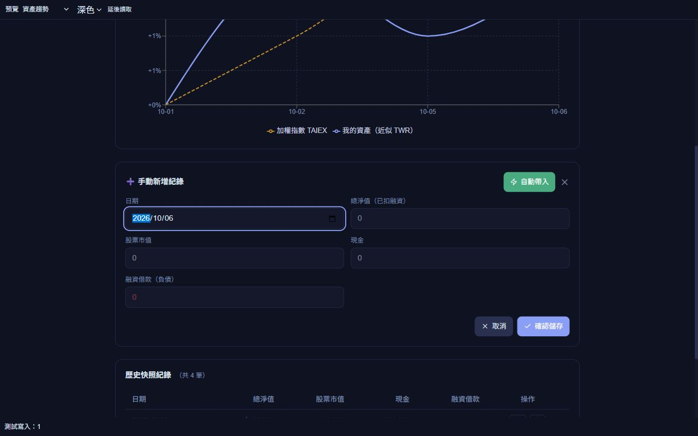

# 每日快照趨勢模式 — v26.10.6.2

依使用者「取消收盤確認，只需要當日資料看趨勢，不強制收盤價」的偏好，取消一般快照的收盤確認要求。與前批報價代理逾時修正合併為 `v26.10.6.2`，已依使用者本次部署授權上線；詳見 [正式發布紀錄](RELEASE_2026-10-06_v26.10.6.2.md)。

## 使用上的改變

- 歷史快照列表不再顯示「收盤待確認／收盤已確認／盤中估值」，新增與編輯表單移除「估值確認」選項。
- 既有、手動、盤中快照直接納入資產趨勢、近似 TWR、XIRR 與回撤估算，無須逐筆補確認。年度報表與區間說明改稱每日快照估算。
- 儲存今日快照與自動快照只要求所有持股取得當日有效報價，成交價或當日有效參考報價都可使用；不再等待供應商的最終收盤訊號。純現金帳戶也可保存當日快照。
- 同一天維持一筆紀錄：背景已有快照便跳過，明確更新／儲存可以覆寫，仍保留原有 60 秒寫入節流與帳號隔離。

歷史品質欄位與原始快照沒有批次重寫或刪除。新資料仍可保留來源品質資訊，但不以它阻擋一般趨勢；手動輸入不冒充已確認收盤。隱藏但保留的手動精確 TWR 及其已儲存資料不變。

## 保留的檢查

缺價、失敗報價、來源日期非當日、未知日期或非當日取得的快取，仍不能用來自動保存今日快照。舊快照的保存日期與淨值足以供趨勢估算，不要求補上當年的報價中繼資料。

績效仍拒絕無效／重複日期、無效淨值、未來快照及無法計算的現金流；缺少必要日期的快照也不拿今日股價補造歷史。入金使用實際轉帳日，保留期末／收盤後入金的既有假設，未更改交易成本、股利或融資算法。

## 驗證

- 完整 `npm test` **810／810 通過**，posttest 同步、UI、runtime 分別 3／5／6 項通過；無失敗或略過。
- 全專案 lint、TypeScript 與正式建置通過，既有大型 bundle 提示維持。改動後的隔離瀏覽器測試頁由 Vite 編譯並完成實際操作。
- 重寫收盤強制相關回歸案例，新增盤中自動快照直接保存、舊／盤中端點可由實際年度計算 callback 求報酬、計算不改寫舊品質欄位等驗證。日期、缺價、重複、資料隔離及精確 TWR 測試仍通過。
- 使用隔離記憶體資料的真實產品元件：三筆原始快照（未標記、盤中、手動未確認）均顯示資產曲線與近似 TWR；成功新增第四筆，沒有確認收盤步驟。未連接正式資料庫、報價或 AI；最後檢查 console 警告與錯誤均為空。
- 電腦 1280×800、直向 393×852、橫向 844×390、窄手機 320×640 均檢查：沒有整頁橫向溢出，表單保留五個必要欄位，收盤確認控制項與標籤皆為零；原明暗配色保留。

證據：[尺寸驗證](snapshot-trend-2026-10-06/ui-verification.json)、[桌面](snapshot-trend-2026-10-06/desktop.png)、[手機](snapshot-trend-2026-10-06/portrait.png)。測試金額與曲線為合成資料。

修改位置：`src/lib/performanceReturns.ts`、`pricePolicy.ts`、`snapshot.ts`、`src/pages/invest/AssetTrend.tsx`、`YearReview.tsx`、版本常數、相應測試。使用偏好已寫入 `AGENTS.md`，避免後續更新重新加入強制收盤確認。

本批已與報價修正及新帳號授權一起更新正式網站。後續新的修改批次仍須取得新的部署批准。
