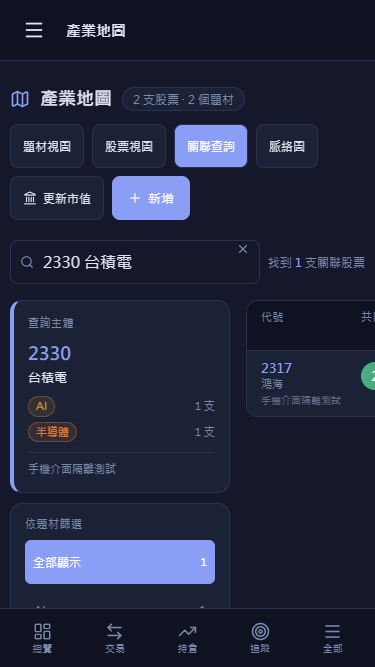
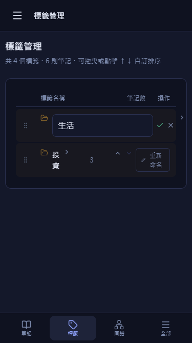
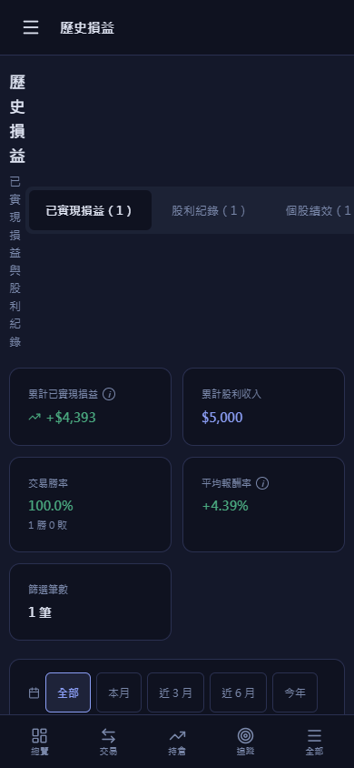
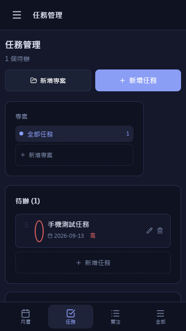
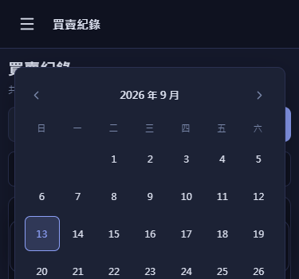

# iPhone 介面與操作檢查 — 2026-09-13

結論：主要頁面已有手機版，但仍有會妨礙操作的問題，不能視為已完成 iPhone 驗收。優先處理任務觸控排序、產業關聯查詢、標籤管理與過窄的操作按鈕。

本次只檢查、建立隔離驗收工具及報告；未修改產品程式碼、未部署、未寫入正式帳號。檢查的是本機工作目錄的現況（包含既有未提交修改），顯示版本為 `v26.9.13.2`，不代表正式站一定是同一份程式。本次沒有修正產品，因此不遞增 APP_VERSION。

## 檢查方式與界線

- 使用本機 Edge／Chromium 的行動裝置觸控模擬，載入正式 App、全域 CSS、各頁面元件及路由。
- 26 個入口 × 4 種 CSS viewport：375×667、390×844、430×932、844×390，共 104 次初始頁面檢查。最後一組檢查橫向行為。
- Firebase／Auth 使用記憶體 fixture；外部網路請求被阻擋。測試帳號、股票、筆記及行程皆為合成資料。行情、Google 及 AI 的外部成功流程不在這個隔離驗收中。
- 另外檢查新增表單、日期選擇器、標籤重新命名、側欄篩選、表格捲動與觸控拖曳；用 DOM 尺寸、觸控事件、記憶體寫入紀錄及截圖交叉確認。
- **沒有使用實體 iPhone 或 Safari／WebKit。** 瀏海安全區、Safari 工具列、真實鍵盤、原生日期選擇器、照片／HEIC、檔案下載及 OAuth 回跳，仍需實機驗收。375×350 只是額外的短高度測試，不能當成 iOS 鍵盤實測。
- 所有入口載入不等於每個功能所有狀態通過。部分頁面只有空資料或少量資料；券商 PDF 辨識、完整對帳、真實報價／AI／同步、大量筆記與完整資料復原未在本次手機測試執行。

## 已重現的問題

### 1. 任務拖曳排序會被觸控捲動取消（優先）

在任務管理加入兩筆任務，以手指拖曳第一筆的把手向下約 84 像素。

- 原始畫面收到 `pointerdown → pointermove → pointercancel`；沒有資料寫入，任務順序不變。
- 只在測試頁 DOM 暫時對把手設定 `touch-action: none`，重做同一手勢，就收到 `pointerup`，兩筆 order 正常交換。
- 原因位置：`src/pages/calendar/TaskManager.tsx:62` 的拖曳把手，以及 `:124` 的 PointerSensor；把手未指定觸控手勢政策。
- 建議只對拖曳把手處理 touch-action，保留其他區域捲動，並提供上移／下移操作。不要對整個任務區禁用捲動。

證據：[觸控事件與前後 order](iphone-ui-audit-2026-09-13/touch.json)。這是 Chromium 觸控模擬重現，iOS 上仍應回歸驗收。

### 2. 產業地圖「關聯查詢」超出手機畫面（優先）

375 像素寬 → 產業地圖 → 關聯查詢 → 搜尋 2330 → 選取台積電。

- 搜尋建議固定寬 420 像素，從 x=10 延伸到 x=430。
- 選股後主內容捲動寬達 527 像素，右側結果從 x=246 開始，共同／其他題材落在畫面外，必須移動整頁才能閱讀。
- 原因位置：`src/pages/invest/IndustryMap.tsx:387` 固定下拉寬度，`:412` 的 `220px 1fr` 主欄，以及 `:477`、`:487` 的固定欄位矩陣。
- 建議手機將查詢主體與結果上下排列，下拉限制在可用寬度內，結果改為卡片或獨立的可橫捲區。

### 3. 標籤管理欄位過擠，重新命名會撐寬整頁（優先）

375／390 像素寬 → 標籤管理 → 重新命名。

- 顯示「生活」「投資」等兩字標籤時，名稱已被擠成直行；重新命名按鈕也換行。
- 編輯時 375 像素畫面的 scrollWidth 增至 486 像素，上下移按鈕落到 x=446／468，無法在原畫面直接點選。
- 原因位置：`src/pages/kms/KMSTags.tsx:220`、`:236`、`:292`，固定四欄與名稱輸入框的最小內容寬度。
- 已確認標籤有「上移／下移」替代操作，不能把它誤報為只能拖曳；但目前這些按鈕也太窄。
- 建議手機改為名稱一列、數量與操作另一列；編輯時使用滿寬輸入框。

### 4. 歷史損益分頁列超出画面

375／390 像素寬進入歷史損益，第三個「個股績效」分頁右側被裁切。390 像素時整頁 scrollWidth 為 422；375 像素進入自訂篩選後，另一次測量達 438。

原因位置：`src/pages/invest/HistoryPnL.tsx:231` 的不換行 fit-content 分頁列及 `:239` 的按鈕水平 padding。建議改為三欄等寬、換列，或明確可橫捲的分頁列，避免整頁橫移。

### 5. 多個操作按鈕只有高度被放大，寬度仍不足

在任務列表實測：拖曳與完成按鈕約 18×44，編輯／刪除約 17×44；標籤上下移約 18×44；側欄關閉約 20×20。

全域 `src/index.css:448` 附近只設定 min-height；元件的窄寬度仍保留。任務的圓形完成按鈕因此變成細長橢圓，編輯與刪除也靠得很近。程式沒有失效，但實際觸控容易漏點或誤點。

建議一般操作目標至少朝 44×44 CSS 像素設計；讓圖示維持原尺寸，擴大外部按鈕，而不是拉伸原本的小圓圈。需一併檢查出入金、除權息、標籤及側欄的圖示操作。

### 6. iPhone 橫向寬度會切換回桌面操作

844×390 下，App 把裝置視為桌面：手機上下導覽消失，224 像素側欄常駐，只剩約 620 像素主內容；手機輸入框與按鈕的放大規則也不再套用。

原因位置：`src/App.tsx:546` 及 resize 處理只以 768 像素寬度判斷；全域手機樣式也用相同寬度條件。此為可重現的操作退化，不是頁面崩潰。建議兼顧橫向的低高度與觸控裝置，避免寬度跨過門檻就完全換成桌面操作。

### 7. 知識庫侧欄選標籤後不會收起

375 像素寬 → 知識庫 → 開啟全部功能 → 選「生活」。標籤已更新，但 `.sidebar-backdrop` 仍存在，側欄遮住結果，使用者必須額外關閉側欄才知道有沒有選成功。

原因位置：`src/App.tsx:132` 只更新標籤；`:553` 附近只在 pathname 改變時關側欄。同一路由的標籤選擇不會觸發。建議將標籤選擇的導覽完成動作一起處理，保留獨立的展開／收合樹狀分類操作。

### 8. 月曆與融資管理有輕微整頁橫向溢出（低優先）

- 月曆：375／390 像素畫面分别為 381／396 的 scrollWidth；430 時為 434。篩選列本身從負 x 起始。原因是 `src/pages/calendar/CalendarHome.tsx:417` 的 -16px 邊距，與全域手機頁面 10／12px padding 不一致。
- 融資管理：375 時 scrollWidth=380；畫面卡片右邊界被截一小段，需檢查 grid 子項最小內容寬度。
- 篩選按鈕超出篩選列是正常的局部橫捲；這裡回報的是**篩選容器／整頁本身**超出視窗，沒有把表格合法橫捲一律當成 BUG。

## 已觀察到、仍需 iPhone 實機確認的風險

1. **交易日期選擇器的可見高度不足。** `src/pages/invest/Trades.tsx:956` 將它固定在 top=84px，沒有隨可見高度限制。375×350 額外測試中面板仍高 337.5px，下方日期超出視窗；真實 iOS 鍵盤開啟是否造成同樣遮擋尚未驗證。應測鍵盤、Safari 工具列及直橫切換，而非僅縮小桌面視窗。
2. **選股追蹤線圖的滑動查值。** `src/pages/invest/Watchlist.tsx:177` 只綁定 mousemove／mouseleave，尚未實測真實 iPhone 手指拖過折線時能否連續顯示日期／收盤／成交量。不能僅因滑鼠 hover 正常就判定觸控也通過。

## 功能覆蓋

以下 26 個入口均在四種尺寸載入並量測，最終 104 次沒有未捕捉的頁面例外。表內「未發現」限於本輪的頁面與資料狀態，並非所有操作保證。

| 功能 | 額外檢查／結果 |
| --- | --- |
| 儀表板 | 合成持倉、現金及股利摘要；直向未發現整頁橫向溢出 |
| 買賣紀錄 | 交易列表、新增表單與日期選擇器；短高度面板風險如上 |
| 股票持倉 | 合成持倉手機卡片；未發現初始版面溢出 |
| 選股追蹤 | 入口、補充台股卡片與新增表單；線圖觸控查值待實機 |
| 歷史損益 | 分頁、自訂篩選、表格；發現分頁列溢出 |
| 出入金 | 表單、列表與實際新增；新增成功寫入隔離資料 |
| 除權息 | 表單與合成股利列表；沒有初始頁面例外 |
| 資產趨勢 | 初始頁面與快照輸入相關原始碼檢查；大量快照未測 |
| 年度復盤 | 初始摘要與頁面；長年月表格仍依賴局部橫捲 |
| 每日重點 | 初始頁面；外部新聞、AI 成功流程未測 |
| 融資管理 | 初始空融資情境；375px 輕微溢出；完整融資部位試算未測 |
| 組合水位試算 | 初始頁面；980px 寬明細採局部橫捲，不算整頁溢出，但密集輸入操作仍值得後續改善 |
| 觀點追蹤 | 初始頁面；長期多筆追蹤與外部 AI 未測 |
| 產業地圖 | 題材、股票相關原始碼、關聯查詢、新增、脈絡入口；關聯查詢嚴重溢出 |
| 賣出追蹤 | 合成已賣紀錄的初始頁面；外部最新報價未測 |
| 設定與備份 | 頁首到頁底、匯入匯出入口；未操作正式備份復原與 iOS 下載 |
| 對帳核對 | 初始匯入頁面；未在手機執行 PDF／OCR／完整對帳 |
| 知識庫 | 新增、富文字輸入、上方固定保存、底部捲動、匯入視窗、側欄篩選；合成筆記正文與摘要保存成功 |
| 標籤管理 | 列表、展開、命名、上下移；發現擠壓及編輯溢出；上下移寫入成功 |
| 匯出筆記 | 初始頁面；iOS 下載與分享動作未測 |
| 知識圖譜 | 合成標籤初始頁面與觸控處理原始碼；已有 Touch handlers，不誤報成僅支援滑鼠；大量圖譜未測 |
| 垃圾桶 | 空列表初始頁面；恢復及永久刪除未在此次手機流程執行 |
| 月曆 | 篩選、更多操作、新增視窗捲到底、實際新增；保存成功；輕微整頁溢出 |
| 任務管理 | 新增任務／專案成功、完成與編輯按鈕尺寸、觸控排序；發現排序取消及過窄操作目標 |
| 法說會關注清單 | 初始頁面；外部法說會抓取與同步未測 |
| 登入 | 四種尺寸的表單版面；未測正式登入／帳號切換／OAuth |

## 驗證結果與重現檔

- `npm test`：384 項通過，0 失敗。既有測試不能涵蓋本次發現的觸控／排版問題。
- 六項隔離操作完成寫入：出入金新增、任務新增、專案新增、行程新增、知識庫筆記與正文保存、標籤上下移。這只驗證前端操作與隔離資料，不等同正式後端整合驗收。
- [104 次頁面量測](iphone-ui-audit-2026-09-13/matrix.json)、[進階操作量測](iphone-ui-audit-2026-09-13/actions.json)、[表單細節](iphone-ui-audit-2026-09-13/details.json)、[觸控排序](iphone-ui-audit-2026-09-13/touch.json)、[保存流程](iphone-ui-audit-2026-09-13/flows.json)。
- actions.json 保留兩個測試選取器失敗的原始紀錄：新增任務有兩個同名按鈕、KMS 按鈕實名為「新增」。後續 details／flows 已用正確選取器完成，這兩個是驗收腳本問題，不列為產品故障。
- 本機隔離工具保留在 `.codex-tmp/iphone-audit/`（git ignored）。執行 `npm exec vite -- --config .codex-tmp/iphone-audit/vite.config.mjs`，開啟 `http://127.0.0.1:5186/.codex-tmp/iphone-audit/index.html?route=%2Finvest`。這個 URL 才是隔離入口；不可拿一般開發入口當成隔離環境。

修正順序建議：先處理 1–3 與 5，再處理分頁列、橫向模式與側欄，最後統一局部捲動與小幅溢出。修正後回歸上述尺寸，並以真實 iPhone Safari 完成鍵盤、安全區、檔案和觸控驗收。
