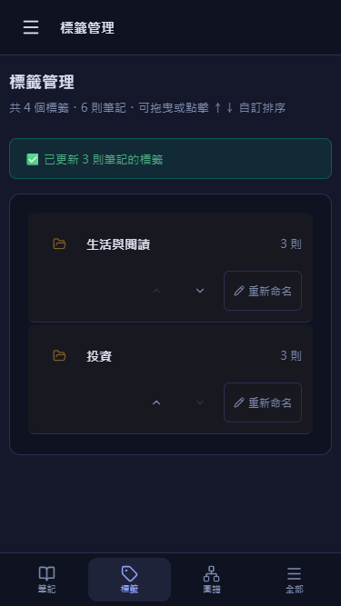
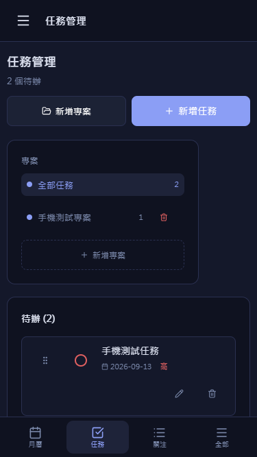
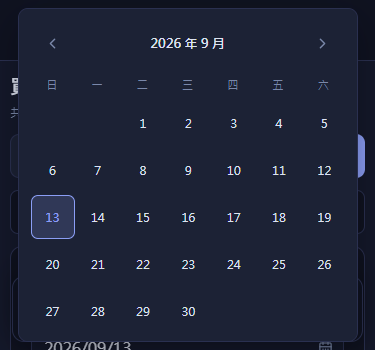
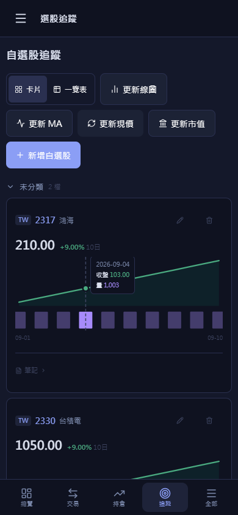

# iPhone 操作修正 — v26.9.13.3

本批依照 [手機介面檢查報告](IPHONE_UI_AUDIT_2026-09-13.md) 修正，保留工作目錄原有變更。未部署，未修改正式帳號資料、備份結構或投資計算。

## 完成項目

- 任務拖曳把手指定觸控手勢處理。原本被瀏覽器取消的拖曳，現在可正常交換任務 order；列表其他區域仍可捲動。
- 操作按鈕擴大可點範圍；任務的完成圖示保持圓形，編輯／刪除排列在獨立操作列，並加上可辨識名稱。
- 產業關聯查詢改為手機上下排列；搜尋建議限制在可用寬度內，結果以兩欄卡片顯示並標明共同／其他題材。
- 標籤管理的名稱與操作分列；長名稱可換行，重新命名輸入框使用完整一列，上下移仍保留。
- 歷史損益分頁改成三欄等寬；自訂日期篩選可換列。
- App、交易頁、知識圖譜共用手機判斷：小螢幕及寬度不超過 950px 的橫向觸控装置。相關手機樣式同步使用相同條件。低於 500px 高度時保留頁首選單，暫時隱藏底部列以騰出空間。
- 知識庫側欄選標籤後關閉遮罩；從其他知識庫頁面選標籤時也會進入筆記頁。
- 月曆篩選列不再使用超出手機邊距的負 margin；融資格線允許縮小；設定頁卡片最小寬度限制在容器內。
- 手機任務表單移除隱性第二欄；橫向組合水位試算的操作列允許換列。
- 交易日期面板依 visualViewport 可見高度定位、限制高度並允許捲動；選取日期後正常關閉。短至 375×350 的畫面也能選到月底。
- 選股追蹤小線圖使用 Pointer Events，手指水平滑動可以查值；保留垂直捲動，修正提示框座標換算。

版本統一為 `src/lib/appVersion.ts` 的 `v26.9.13.3`，本批「繼續」及驗證修正沒有另外遞增版本。

## 本機驗證

- 26 個入口 × 375×667、390×844、430×932、844×390 的頁面量測，使用與稽核相同的正式元件／CSS及隔離服務；結果見 [頁面量測](iphone-ui-fix-2026-09-13/matrix.json)。
- [8 項重點操作檢查](iphone-ui-fix-2026-09-13/acceptance.json) 全數通過：關聯查詢、標籤命名、歷史分頁／日期篩選、44×44 任務按鈕、側欄收起、橫向手機介面、短高度日期選取、線圖觸控查值。
- [觸控排序證據](iphone-ui-fix-2026-09-13/touch.json)：未加入任何測試 DOM 修補時，就收到 pointerup 並成功寫入交換後的順序。
- 桌面 1280×800 的 10 個相關入口也做了版面回歸：桌面側欄保留，沒有頁面例外或整頁橫向溢出。
- `npm test`：384/384 通過。`npm run lint` 與 `npm run build` 通過；build 仍有既有大型 chunk 警告。

本機的網路、登入與資料寫入使用記憶體 fixture；上述結果不等同正式 Firebase／Google／AI 整合測試。仍未使用實體 iPhone Safari，原生鍵盤、工具列、安全區、檔案上傳下載及 OAuth 仍需實機確認。

## 修正後截圖

本批尚未部署，待使用者明確批准後再一起發布。
