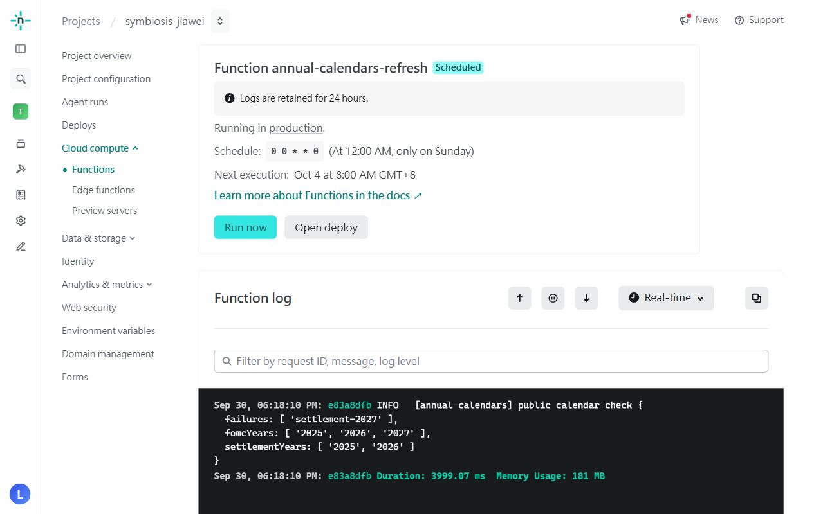

# 2026-09-30 正式上線與年度排程啟用

使用者本次明確指示「現在部署正式上線，以及啟用排程」。正式版本維持已完成批次 `v26.9.30.7`，部署本身不增加程式版本。

- 正式站：[symbiosis-jiawei.netlify.app](https://symbiosis-jiawei.netlify.app/)
- 正式部署：`6abce0bc4737eddeadab62b3`，production／ready。
- 上一版：`6ab76c796482ef3bdd06aa30`。發布後原部署鎖已恢復並確認。
- 前端入口與已驗證本機產物 SHA-256 相同：`c357a3fbc596d05e69d6532b58a568b42eed77928c6885e595cb8304f752db37`。
- 編譯後實際共用行情路徑確認富邦開關為 true。掃描 91 個前端 HTML／CSS／JS 等檔案，無伺服器私鑰或機密設定標記，無臨時 QA 頁。

## 同批發布

發布目前已完成的前端與 Netlify Functions，包含匯入／還原保護、錯誤處理、年度日程、Google 連結安全及現價更新等待改善。沿用原有 Netlify／Firebase 設定與 IAM 權限；未新增平台、金鑰或 Google scope，未部署新的 Firebase 規則或雲端函式。

Google 安全檢查要求前端新增 Authorization 與後端同時發布。舊開頁面須重新整理。既有有效 Google 連結保留，這次沒有執行私人 Google 日程同步或重新授權驗收，也沒有為驗收更新使用者報價、資產快照、交易或現金資料。

## 年度排程及首次實際執行

- `annual-calendars-refresh` 已於正式部署註冊，Netlify 顯示 Scheduled。
- 排程 `0 0 * * 0`：每週日台灣時間 08:00。下次自動執行為 **2026-10-04 08:00 GMT+8**。部署鎖不影響已發布函式的定時執行。
- 2026-09-30 18:18 以 Netlify Run now 執行首次正式更新，日誌確認完成，耗時 3999.07 ms。
- 隨後使用既有 Firebase CLI 身分，**只讀取** `sharedData/annualCalendars`，確認資料確實保存並通過正式日期驗證器：2025／2026／2027 FOMC 各 8 筆，2025／2026 交割休假各 16 筆。各年份 checkedAt 為 `2026-09-30T10:18:07.964Z`。
- 2027 交割資料仍未公布，記為 `settlement-2027`，沒有以錯年份或空清單覆蓋資料；後續每週自動重查。畫面日誌的這一項 failures 代表該年份尚無完整資料，並非整次排程失敗。
- 首次排程僅保存公開年度日程；未讀取任何 user collection。既有秘密值保持 Netlify 保護，沒有另存憑證檔案或加入前端。

## 發布驗證與一次檢查腳本修正

- 完整 655 項測試、6 項函式 runtime 檢查通過；本批 lint 與 TypeScript／正式建置通過。
- 12 個受保護端點各做匿名及無效憑證檢查，共 24 項回覆 401，沒有用量寫入或 Google 上游呼叫。涵蓋新年度日程 API、Google connect／ensure／pull／sync／series 與現有行情代理。
- 首次發布的驗證腳本用 `{}` 呼叫 Google 系列 API，該端點在驗證登入前先拒絕不完整參數，因此正常回覆 400。腳本誤判並自動恢復上一版；修正為格式完整的虛構 read 參數後，重新發布**同一個已上傳部署**，24 項檢查通過。沒有改動產品程式或重複建置／上傳。
- 原部署鎖已恢復，正式發佈狀態、入口檔 hash 與排程註冊均確認。

現價改善已正式發布，但本次沒有執行私人投資帳號更新來量測秒數；不能以排程的約 4 秒耗時當成現價更新耗時。Google 實際 OAuth／既有連結同步的驗證限制仍保留。
