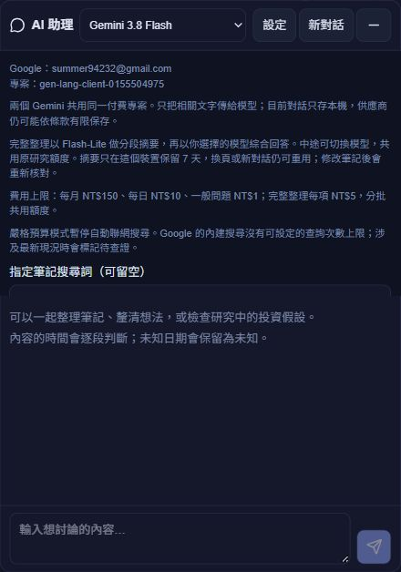

# 2026-10-06 正式發布 — v26.10.5.1

依使用者本次「幫我把最新的版本部署上線」授權，發布目前已完成驗證的版本。版本標籤保留程式更新日期 10/05，本次部署沒有新增產品修正或另增版本號。

- 正式網站：[Symbiosis](https://symbiosis-jiawei.netlify.app/invest)。
- Netlify 部署：`6ac492dcba0c0677602c285f`，`ready`／`production`；[部署紀錄](https://app.netlify.com/projects/symbiosis-jiawei/deploys/6ac492dcba0c0677602c285f)。
- 前版：`6abffdc45a2b121688f0bba2`。本次僅建立 **一個 Netlify 正式部署**，沒有建立預覽部署或第二版；發布後恢復原部署鎖。

## 發布內容與設定

包含 AI 預算／分批長文閱讀／對話重點／摘要重用、模型狀態與預測確定程度修正，以及 10/04–10/05 的帳務、績效、KMS 匯出與表單回歸修正。細節與已知能力邊界見 [AI 驗收](AI_LIVE_ACCEPTANCE_2026-10-04.md)、[系統修正](AUDIT_FIXES_2026-10-04.md) 與 [後續複查](AUDIT_RECHECK_2026-10-05.md)。

17 支 Netlify Functions 使用現代 runtime API v2 完成本機打包並發布。AI 仍使用核准的 Google 帳號 `summer94232@gmail.com`、專案 `gen-lang-client-0155504975`；Gemini 3.8 Flash／3.5 Flash-Lite 啟用，GPT／Claude 未啟用。

20 項部署覆寫全部限定 `functions` 範圍，Gemini、KMS 服務帳號與 Fugle 金鑰列為 secret。正式 AI 設定確認為每月 NT$150、每日 NT$10、一般一輪 NT$1、同項完整研究 NT$5。原登入、Google 行事曆及既有行情設定維持原帳號與範圍。

Fugle 行情透過登入保護的後端代理取得；新版前端不含 Fugle／Gemini 金鑰，站台舊 `VITE_FUGLE_API_KEY` 已移除。使用者最後明確指定 **沿用原 Fugle 金鑰**，此次沒有輪替或撤銷它；過去公開版本的金鑰暴露不會因後端化而自動撤銷。

**後續部署仍須攜帶 20 項 Functions 專用覆寫**：`local-secrets/ai-netlify-functions.env` 的 19 項，加上 `.env` 的 `FUGLE_API_KEY`。這些覆寫不是持久的站台變數，不可直接省略，也不可改放進前端或 Git。

## Firebase

更新既有四個 KMS 函式與安全依賴：`maintainKmsFullTextNotes`、`maintainKmsFullTextBodies`、`maintainKmsNoteMetadata`、`cleanupKmsImageDrafts`。正式確認四個均為 `ACTIVE`、Node.js 22，更新日期為 10/06；沒有新增或刪除其他函式。

投資／KMS Firestore 與 KMS Storage 正式規則均與本機相符，因此不重複部署規則。Netlify 既有年度更新排程 `annual-calendars-refresh` 保留。先前取消的 Codex AI 接續排程沒有重建。

## 上線驗收

- 複用 10/05 已完成的完整 804 項測試、後續聚焦測試、lint 與 17 項模擬器證據；本次重新執行正式建置及其 6 項 runtime 檢查，均通過。既有大型 bundle 提示仍存在。
- 正式入口與 **90 個 JavaScript／CSS 執行資產**的 SHA256 皆與本機發布檔相符；瀏覽器顯示 `v26.10.5.1`。
- 16 個受保護端點的匿名與無效憑證共 **32 個請求**均回覆 401；AI GET 回覆 405。
- 真實 Firebase 登入與正式 AI status 成功，核對原 Google 帳號／專案／金鑰指紋、兩個可用 Gemini 與 150／10／1／5 預算。
- 兩個 Gemini 的正式簡短生成與費用結算成功，分別 NT$0.05／NT$0.02，合計估算 **NT$0.07**；沒有私人筆記證據、聯網、筆記儲存或偏好儲存。
- 使用者指定沿用的 Fugle 金鑰在發布前取得公開 0050 報價；發布後真實登入的 Fugle 代理也回覆 200。兩次各一筆，均經既有共用報價額度預約。
- Netlify 正式部署鎖、年度排程與四個 Firebase 函式狀態均確認成功，共 **18 項正式驗收檢查通過**。

驗收只產生必要登入及用量／報價額度紀錄，沒有修改私人投資帳本、筆記或長期偏好。AI 成本是本系統依價格與匯率的估算，不是整個 Google 帳號帳單上限。

正式網頁已登入，顯示 `v26.10.5.1`；AI 設定也實際顯示兩個 Gemini、原 Google 帳號／專案及 NT$150 上限。未另外在瀏覽器送出付費問題。

安全收據：[發布](../log/release-2026-10-06.json)、[正式驗收](../log/release-2026-10-06-verification.json)。本機過程檔保存在被 Git 忽略的 `.codex-tmp/release-2026-10-06-*`，不含於前端發布目錄；機密設定不得提交或分享。

請重新整理已開啟的正式頁面，確認版本 `v26.10.5.1`。
