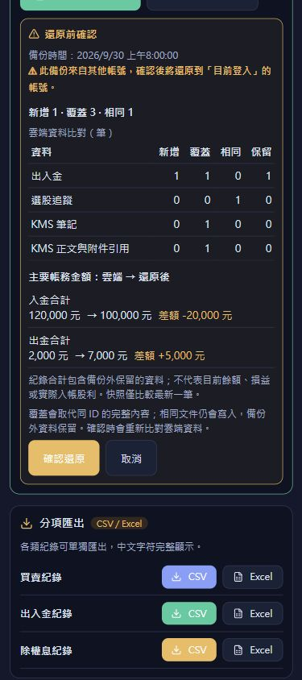
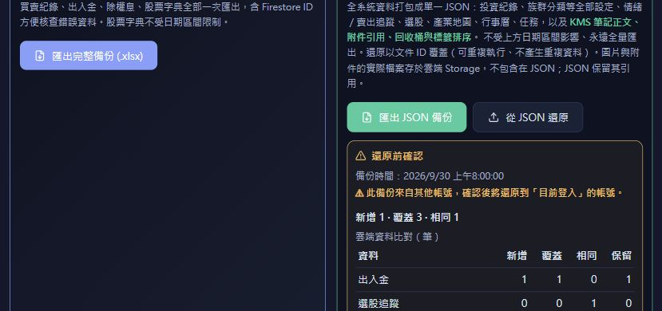
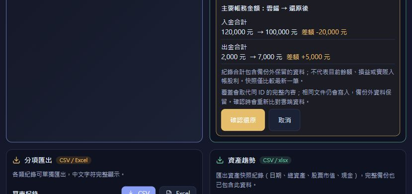

# 還原差異預覽與操作文件更新

程式版本：`v26.9.30.4`。本批完成本機驗證，尚未部署。

## 還原差異預覽

- 設定與備份選擇 JSON 後，使用伺服器資料比對白名單集合，列出新增、內容覆蓋、相同及備份外保留的文件數。
- 比對完整文件內容，忽略物件鍵及文件讀取順序差異；陣列順序仍有意義。KMS 舊版內嵌正文先用與還原相同的流程重建，預覽包含實際會覆蓋的 `noteBodies`。
- 同類重複 ID 以最後有效文件計算差異，另顯示重複及略過筆數；帳務重複 ID 繼續拒絕。
- 買入／賣出收付、入金／出金、現金股利紀錄金額比較包含保留資料，不當作餘額或損益。最新快照按日期比較，不合計歷史資產；無法確定的金額不當作零。
- 預覽綁定兩邊 Auth 的登入物件。確認前重新讀取相關集合，比對帳號、檔案與資料；變更、讀取失敗或無效預覽均在第一批寫入前中止。帳務合併檢查沿用既有安全驗證。
- 檔案讀取／預覽失敗清除舊預覽，重選同檔可重試。畫面只顯示分類統計與主要金額，不顯示私密設定內容；比對基準只存於記憶體。

## 文件

README、系統手冊及路線圖更新過時的測試／lint 基線，補齊 CSV 部分成功、JSON 備份還原、Google 同步、錯誤復原、年度缺漏及故障處理。部署仍需當批明確同意；原有密碼保存、Storage 原檔未備份、年度資料維護與前端快照限制仍列為待辦。

## 驗證

- 新增差異／金額／KMS 重建／過期預覽／帳號切換／UI handler 測試 23 項。
- 完整 `npm test`：550/550 通過，後續函式執行環境檢查 6/6 通過。
- 最後細節調整後，差異預覽、匯入還原安全及資料安全的針對性回歸 72/72 通過；TypeScript、Vite build 與零警告 lint 通過。Vite 仍有既有的大型 chunk 提醒。
- 使用實際 `InvestSettings`、實際還原模組及記憶體 Firestore 的隔離瀏覽器頁驗證：檔案選擇產生正確差異，預覽寫入 0 批；模擬雲端變更後確認中止且仍為 0 批；取消清除預覽；重做預覽確認後完成 4 批、5 筆測試文件。
- 手機 390×844 及 844×390 驗證表格、金額換行、捲動與 44px 確認按鈕。橫向頁面沒有水平溢出。
- 本次未執行 Firebase emulator，沒有修改正式帳號資料、正式規則或部署。

## 保護範圍

預覽和確認會各讀一次相關集合，計入現有 Firebase 讀取額度，不新增平台或訂閱。比對是寫入前預檢，不會鎖定其他裝置；跨集合、跨專案及每 400 筆的批次仍沒有整體回滾。中途失敗須先核對已完成資料，重新選檔產生新預覽後再決定續做。備份外文件保留，還原不是鏡像刪除；圖片／附件原檔不在 JSON 內。

## 畫面證據

全部使用虛構測試資料。

