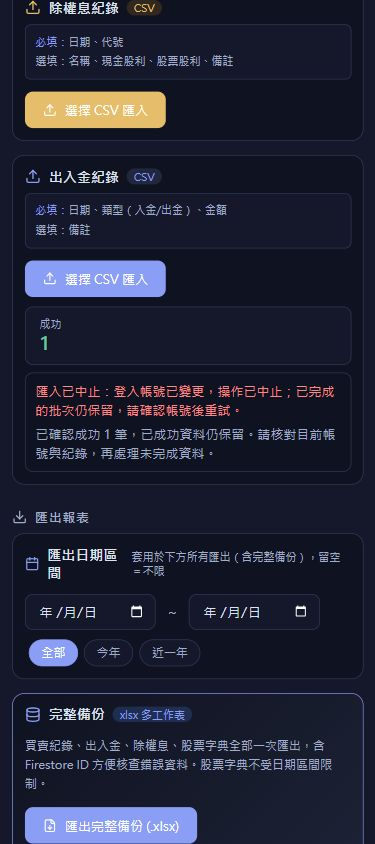
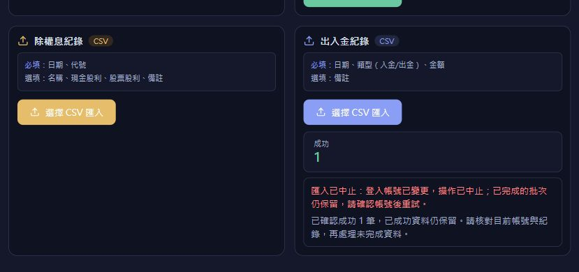

# 設定頁匯入防護補齊

版本：`v26.9.30.5`。補齊先前 CSV 防護的入口範圍，未部署。

## 範圍與行為

- 先前已保護買賣紀錄頁 CSV 及 JSON 還原；本批補到設定與備份頁的交易 CSV、出入金 CSV、股利 CSV、股票字典 Excel 四個獨立入口。
- 讀檔前捕捉兩邊 Firebase Auth 的登入物件，所有查詢及寫入使用固定帳號路徑。查詢、檔案讀取、每筆主資料寫入及股票名稱更新後重新核對登入狀態；更換帳號或重新登入即中止。
- 讀檔、查詢、寫入失敗及空 CSV 都會解除忙碌狀態與操作鎖、清空檔案輸入並保留結果，使用者可以重選同檔。
- 已確認的主資料寫入先計成功，再檢查帳號及更新字典。交易／股利成功而字典失敗時，保留成功筆數，不重複計失敗，並停止剩餘列。
- 寫入失敗或成功回覆遺失時，不自動重送，顯示「寫入未確認」，先核對紀錄後再處理。格式不合法的列繼續列為失敗／略過，原有查重、費稅、融資、股利日期及帳本判斷保留。
- 四個入口共用同步操作鎖，避免重複點選或同頁同時執行其他匯入；JSON 還原期間不能開始匯入，匯入期間不能確認 JSON 還原。
- 每個匯入卡片持續顯示中止原因與已確認成功筆數，不依賴五秒後消失的頁面提示。成功後沿用原筆數區塊。
- 股票名稱僅在字典成功且原登入狀態仍有效時更新本機快取，完成或中止時清除相關快取。

## 驗證

- `settings-import-safety.test.mjs` 新增 46 項，執行實際四個 handler、實際帳號綁定工具、財務驗證與 Excel 解析。
- 新增測試涵蓋正常匯入、各等待邊界切換帳號、同 UID 重新登入、讀檔／查詢／寫入失敗、回覆遺失、已成功主資料的字典失敗、有效／無效／重複混合列、來源 ID、超賣、操作鎖及提示呈現。
- 與既有買賣紀錄頁匯入、JSON 還原及差異預覽一起驗證：95/95 通過。修改範圍集中在單一設定頁與提示元件，依專案要求採針對性測試，本批未重跑完整套件。
- `npm run build` 通過 TypeScript 與 Vite；前置函式執行環境檢查 6/6 通過。零警告 lint 與修改檔案的 whitespace 檢查通過；既有大型 chunk 提醒仍在。
- 隔離瀏覽器使用實際設定頁及記憶體服務：查詢失敗顯示持續提示、解除忙碌並可重試同檔；正常重試成功 2 筆；第一筆延遲期間四個匯入入口都停用；切換帳號後第一筆仍只寫原帳號、第二筆不執行，畫面成功數為 1。
- 手機 390×844、844×390 中止原因及筆數可讀，橫向無水平溢出。

沒有新增平台、API 或正式資料操作；未修改 Firestore 規則、備份 schema 或財務時點假設。匯入逐筆寫入，先前成功資料不回滾，回覆遺失的一筆也可能已送達；操作提示及手冊要求先核對後重試。

## 虛構資料畫面

