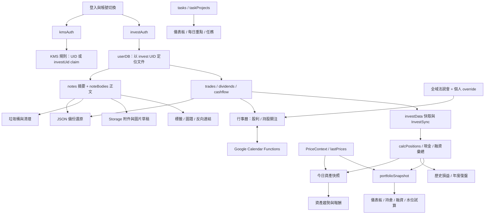

# Symbiosis 完整系統程式碼檢查報告

檢查日期：2026-09-07（Asia/Taipei）  
檢查版本：`d207d5e69419166f016668ad34076b9690a3ce3f`  
檢查方式：原始碼盤點、核心資料流人工追蹤、現有測試、正式建置、ESLint、隔離模擬重現。  
本次變更：僅新增本報告、檢查清單、重現腳本與證據檔；未修正產品程式碼、未部署、未讀寫正式 Firebase／Google 行事曆資料。

## 1. 整體結論

**系統能編譯，主要交易計算的既有測試通過，但仍有會造成資料遺失、帳務失真與帳號資料混用的實質缺陷，尚不能判定為全面可靠。**

本次整理 **20 項發現：12 項 P1、8 項 P2**。其中 F01–F14 使用實際原始碼或抽取的原函式，在隔離環境重現 **16 種情境**；F15–F20 由呼叫端、寫入端及讀取端交叉追蹤確認。P1 表示應優先修正的資料完整性／安全／重大計算問題；P2 表示特定操作、邊界或一致性問題。這些等級是修正優先順序，並不代表已發生正式資料損失或安全事件。

最優先的五個問題：

1. **「完整備份」缺少知識庫正文**：新版內容存在 `noteBodies`，備份只收 `notes`、`trash`；復原後可能只剩標題。
2. **Google 同步會誤判刪除**：已過期、未選取類型及系統生成的事件，可能被當成「本機已刪除」。
3. **融資本金算法不一致**：償還估算採 FIFO，剩餘負債採平均比例扣減；同一組交易的本金不守恆。
4. **知識庫圖片清理可能刪掉正式圖片**：前端清理只查 `notes`／`trash`，未查真正保存圖片引用的 `noteBodies`。
5. **自訂年度報酬漏掉回收本金**：成本 100,000、全數賣得 110,000 的案例，程式算出約 −90.02%，而非約 +10%。

## 2. 檢查範圍與驗證結果

### 2.1 範圍

盤點目前 Git 追蹤的 **124 個 TS／TSX／JS／MJS／CJS／Python 檔案，30,958 行**，包含測試、工具與設定程式；不是 124 個獨立產品功能。另檢視 Firebase 規則、Netlify 設定、套件腳本、既有報告與排程工作。`App.tsx` 登記 27 個 Route（含根路由轉址）。

- 前端：投資、知識庫、行事曆、登入、Context、共用工具、匯入匯出。
- 後端：9 個 Netlify Functions、2 個 Firebase Functions。
- 資料：投資帳本、快照、報价、知識庫摘要／正文／附件、標籤統計、任務、Google 同步。
- 維運：規則與規則測試、UID 對照、資料遷移／備份／清理腳本、GitHub 排程。

**覆蓋深度有差別**：全檔案完成結構盤點；人工深入檢查集中在計算、資料寫入、關聯、同步、刪除、備份及安全邊界。未逐一實際點擊所有 UI，未聲稱每個分支都測過。外部服務內容、正式資料品質及已部署版本不由本次本機檢查推定。

### 2.2 實際執行

| 項目 | 結果 | 可證明與限制 |
|---|---|---|
| `npm test` | **123 / 123 通過** | 涵蓋核心、交易矩陣、當沖與交易列表；不是全系統端到端驗證 |
| `npm run build` | **通過** | TypeScript 與 Vite 正式建置成功；2,754 modules transformed |
| `npm run lint` | **失敗：69 errors、10 warnings** | 型別、未使用變數、Hooks 等；不能把 79 項全部視為已發生的執行錯誤 |
| `npm run test:kms-rules` | **未能啟動測試** | 先遇 Firebase CLI config 讀取權限問題；改用暫存設定目錄後，確認缺少可執行的 Java，`java -version` 無法啟動 |
| 本次重現腳本 | **16 個缺陷情境確認** | mock 取代遠端 I/O，直接執行原函式；F10 另使用已安裝 Firebase SDK 驗證 undefined 拒收，未 commit |
| 正式登入／Google OAuth／市場 API／規則部署 | **未執行** | 不能認定正式端已套用 repo 規則或已遭影響 |

建置另有大型 chunk 警告：`heic2any` 約 1.35 MB、PDF worker 約 1.26 MB（未壓縮）。這是載入與記憶體風險提示，不是建置失敗。

### 2.3 可交付證據

- [重現腳本](../scripts/audit-system-2026-09-07.mjs)
- [逐案例實際結果](SYSTEM_AUDIT_2026-09-07_EVIDENCE.json)
- [全檔案、匯入、集合與路由盤點](SYSTEM_AUDIT_2026-09-07_INVENTORY.json)

執行方式：`node scripts/audit-system-2026-09-07.mjs`。**此腳本的 assertions 是確認現有缺陷，通過不表示功能正確**；修正後應將案例改寫成期待正確行為的正式回歸測試。腳本不載入真實憑證、不呼叫遠端服務，只更新本機證據與盤點 JSON。

## 3. 功能連結與資料流

主要一致性斷點為：`noteBodies → 備份／清理`、`FIFO 本金 → 比例負債`、`局部行事曆讀取 → 全量刪除判斷`、`報價局部成功 → 全表最新時間`，以及非同步工作跨帳號續寫。

### 各功能檢查摘要

| 模組 | 觀察 | 相關發現／尚待驗證 |
|---|---|---|
| 登入／帳號切換 | 雙 Auth 失敗回滾、email 比對、App 以 UID 重掛載已有保護 | 模組全域狀態、進行中寫入仍未完全隔離：F07、F13、F16、F19 |
| 買賣／當沖／歷史損益 | 既有配對、費稅分攤、同日排序、超賣與 CSV 測試通過 | 融資本金 F03；編輯歷史交易後續帳本有效性仍需更廣驗證 |
| 出入金／除權息 | 共用驗證及快取失效存在；現金股利有统一納入 | 未來資料進入今日帳務 F12；失敗處理仍不完整 |
| 持倉／儀表板 | 大部分彙總改用 portfolioSnapshot | F03、F11、F12 會向下游傳播 |
| 融資管理 | 壓力測試與自訂門檻已有測試 | 本金母數 F03；實際券商批次結算仍須核對 |
| 水位試算 | 基本分配、風險、只加碼等有測試 | 超賣試算仍參與總額 F05；方案跨帳號 F19 |
| 資產趨勢／年度復盤 | 現金股利重複計算等舊問題已有改善 | F04、F09、F11、F12；歷史估值及 TWR 近似限制見第 5 節 |
| 券商對帳 | 月結、OCR、庫存、股利與現金口徑有 fixture 驗證 | 未用使用者全部實際月結單重做對帳 |
| 選股／賣出追蹤／觀點 | 報价、均線、分類、狀態的來源可追溯 | 受報价新鮮度影響；未做外部 API 全市場實測 |
| 產業地圖／產業關聯 | 集合与讀寫路徑已盤點 | 刪除節點的關聯殘留及多步儲存中斷需補整合測試 |
| 知識庫／富文字 | 摘要和正文分存，主儲存使用 batch | F01、F06、F10、F15、F20 |
| 標籤／圖譜 | 圖譜讀取摘要、標籤索引由前後端維護 | F08、F15；統計重建與事件時序需驗證 |
| 垃圾桶／附件 | 一般刪除保留正文，復原沿用原 ID | F06、F14、F15；清理與復原競爭需測試 |
| KMS 專屬匯出 | 會透過 fetchKmsBodiesInBatches 取正文 | 與 F01 的全系統 JSON 備份不同，不應一概判定所有匯出缺正文 |
| 行事曆／Google | 系統事件、手動事件、股利及法說會共用展示 | F02、F17、F18；非同步寫回与任務同步不足 |
| 任務／每日重點 | 共用 planner 快取、拖曳排序測試通過 | 缺少跨裝置訂閱及 mutation 失敗一致性測試 |
| 備份／健康中心 | 有白名單、預覽、分批及資料健康檢查 | F01、F13；健康中心不是完整 schema 驗證器 |
| 規則／維運 | repo 已具投資和 KMS 規則、測試、UID 映射工具 | emulator 與部署狀態未驗證；F14；CI 品質關卡不足 |

## 4. 缺陷明細

### F01 · P1 · 完整 JSON 備份漏掉 KMS 正文及設定

**位置**：`src/lib/backup.ts:80`（KMS_COLLECTIONS）、`src/pages/kms/KMSHome.tsx:64`、`:68`、`:576`、`src/lib/kmsData.ts:161`。

新版儲存將 `contentDoc`、`assets` 移到 `noteBodies`，摘要 `content` 為空。備份白名單仍只有 `notes`、`trash`，沒有正文與 KMS `settings/tagOrder`。還原到空環境會失去文章內容；還原到已有資料的環境則可能使舊摘要與較新正文錯配。

**重現**：mock 同時放入摘要與正文，執行 `buildFullBackup()`，輸出只有 `notes`、`trash`，`noteBodies` 為 undefined。

**修正與驗收**：提升備份格式版本，加入正文、設定及必要 metadata；媒體二進位是否涵蓋須另行標明。驗收需「新建富文字與圖片 → 備份 → 空環境復原 → 正文／附件引用／排序一致」。只核對文件筆數不足以驗收。

### F02 · P1 · 行事曆局部查詢被拿來判定 Google 事件應刪除

**位置**：`src/lib/googleCalendar.ts:271`、`:287`、`:310`、`:493`；`netlify/functions/google-calendar-pull.js:39`。

本機 map 只保留今天起未來半年且屬於勾選類型的 `calendarEvents`，Google pull 卻含前後半年及生成事件。任何有 sourceId、但不在本機 map 的事件均被加入刪除清單。「未納入本次範圍」不等於「使用者刪除」。

**重現**：生成法說會事件、仍存在的過去個人事件、取消勾選的科技事件，三種都產生 `deleteGoogleEventIds=['g']`。生成事件若同時在本次推送清單中，可能又被重建；若不在則直接消失。這也違反程式註解宣稱的 B 類只新增策略。

**修正與驗收**：區分 A／B 類與 sourceType，建立明確刪除紀錄（tombstone）或完整存在性查詢；不得用篩選集合的缺席推導刪除。驗證過期、取消勾選、移出半年範圍、生成事件、真刪除五種情境。

### F03 · P1 · 融資償還與剩餘借款使用不同批次算法

**位置**：`src/lib/calc.ts:374`、`:384`、`:581`、`:910`。

`estimateMarginRepayment()` 逐批 FIFO 取本金；`aggregateMarginPositions()` 和 `calcPositions()` 則按股數比例扣當時總借款，且不以此次實際本金欄位銷帳。

**重現**：100 元、200 元各融資買入 1,000 股，借款分別 60,000、120,000。賣出 1,000 股，FIFO 估償本金 60,000，但剩餘負債顯示 90,000；原借款 180,000 與「已還 60,000＋餘額 90,000」差 30,000。

**影響**：儀表板淨值、持倉自備款報酬、維持率、快照、年度績效同步失真。不是單純利息四捨五入。

**修正與驗收**：先選定一致批次模型，讓還款、本金餘額、利息及成本共用帳本；人工本金覆寫也必須一致處理。驗證多買價、部分卖出、人工本金、不同券商帳戶及全部平倉後本金守恆。

### F04 · P1 · 年度自訂報酬終值漏掉已售持倉本金

**位置**：`src/pages/invest/YearReview.tsx:378`、`:398`、`:405`、`:417`。

終值為「剩餘持倉市值＋已實現損益＋股利」，已售持倉的本金沒有加回，又混用帳戶出入金作 XIRR 現金流，並非完整帳戶模型或完整持倉模型。

**重現**：期初持倉成本 100,000、期中全賣得 110,000、無其他流量，終值只剩 10,000；一年區間求得 **−90.0158%**。本金回收 110,000 時應約 +10%（精確年化受天數慣例影響）。

**修正與驗收**：採「期初／末帳戶淨值＋外部流量」，或完整「買賣收付＋持倉期末淨值」，不可混合。至少驗證全平倉、部分平倉、現金留存、出金及融資。歷史日期使用目前價格另見第 5 節。

### F05 · P2 · 整張試算可超賣，且虛增試算現金

**位置**：`src/lib/calc.ts:758`、`:775`；`src/pages/invest/PortfolioPlanner.tsx:275`、`:463`。

股數透過 `Math.max(lotSize, round(...))` 強制至少一張，沒有上限；賣出市值則 clamp 為零，但現金仍加完整超賣金額。

**重現**：100 股、100 元、市值 10,000、目標清倉、整張模式，建議賣 1,000 股、收回 100,000。UI **已有「超過持股」提示**，所以不是無提示的下單漏洞，且系統沒有自動送單；問題是無效交易仍參與總現金與風險計算。

**修正與驗收**：無法合法整張賣出時顯示不可執行／改零股建議，或限制合法股數；總額不應含無效列。另檢查缺價格但 action=hold 時的 `0 * null`／`0 * undefined` 差異。

### F06 · P1 · 前端逾期圖片草稿清理忽略 noteBodies

**位置**：`src/lib/kmsImages.ts:329`、`:341`；`src/pages/kms/KMSHome.tsx:245`、`:581`。

已保存圖片的引用位於正文，清理卻只查摘要和垃圾桶。若保存成功、清除本機草稿前關閉頁面或發生例外，24 小時後進入知識庫可能自動刪正式圖檔。

**重現**：正文仍有 asset，摘要無 assets，放入逾期本機草稿後執行原清理函式；實際只讀 `notes`、`trash`，並呼叫刪圖。後端排程已讀 noteBodies，但不會替前端補上保護。

**修正與驗收**：前後端共用引用判斷；檢查正文、摘要、垃圾桶後才刪除，讀取失敗應保留。測試「正文保存成功但 finalize 前中斷」，下次清理必須保留圖檔。

### F07 · P2 · 自動快照狀態未按 UID 隔離

**位置**：`src/lib/snapshot.ts:187`、`:189`、`:238`。

`coveredDate`、`lastAutoWriteTs`、`autoSnapInFlight` 是模組全域。App 重掛載不會重置 ES module 狀態，切帳號也沒有清除。

**重現**：A 今日已有快照，檢查後切 B；B 未讀 DB 就回 `already-covered`。手動現價更新的 overwrite 可能之後補寫，但不能消除首次漏寫問題。

**修正與驗收**：改 UID＋日期鍵或登入 session 實例。A／B 同日依序登入、60 秒內切換、刪除今日快照後補寫都要獨立處理。

### F08 · P2 · 標籤統計函式不具事件冪等性

**位置**：`firebase-functions/index.js:42`、`:70`、`:84`。

統計每次收到事件就依 before／after 加減，沒有 event ID 去重。transaction 只避免同時更新丟失，不能避免相同事件重送後重複加總。

**重現**：同一「建立一則筆記」事件呼叫兩次，`totalNotes=2`、`counts.tag=2`，實際只應為 1。Firebase 明確說明 Firestore 事件可能重送且不保證排序，不能依賴 `retry:false` 取得 exactly-once。[Firebase 官方說明](https://firebase.google.com/docs/functions/firestore-events)

**修正與驗收**：在同一 transaction 記錄去重狀態或按筆記版本維護貢獻，再配合重建機制。測試重送、亂序、建立後立即刪除；不要只測順序理想事件。

### F09 · P1 · 資產歸零時，報酬曲線顯示零變化

**位置**：`src/pages/invest/AssetTrend.tsx:388`、`:395`。

當段報酬係數為零或負數，程式略過，等同該段係數為 1。這會隱藏完全虧損及槓桿跌破淨值零的情況。

**重現**：100,000 → 0，無出入金，原 memo callback 輸出 0% 而非 −100%。

**修正與驗收**：零係數应保留；負淨值需標記報酬模型失效或清楚呈現，不可默認無變化。驗證歸零、負淨值、純出金及重新入金。

### F10 · P2 · 未操作正文的筆記可能因 undefined 儲存失敗

**位置**：`src/pages/kms/KMSHome.tsx:64`、`:576`；`src/components/kms/RichTextEditor.tsx:196`；`src/lib/firebase.ts:26`。

`noteBody()` 一律寫出 `contentDoc: note.contentDoc`；新筆記只填標題／網址、或舊筆記只改標題時，此值可能為 undefined。編輯器 onCreate 不會回填 JSON，只有 onUpdate 才回填；Firebase 未設定 ignoreUndefinedProperties。

**重現**：由原 noteBody 產生內容，再使用本機已安裝 SDK 的 `writeBatch().set()`，在送網路前就拋出 undefined 錯誤，整批保存不成功。

**修正與驗收**：產生明確預設 doc 或省略 undefined 欄位。驗證只填標題、網址收藏、只改標題及空正文，不能依賴使用者先在編輯器打字。

### F11 · P1 · 部分報價失敗，舊價仍被標記為今日可用

**位置**：`src/PriceContext.tsx:128`、`:135`、`:142`；`src/lib/snapshot.ts:258`。

更新只寫成功代號，`merge:true` 保留失敗代號舊價，但共同 `_updatedAt` 一律更新。只要任一代號成功，就觸發自動快照；快照只驗全表時間和正價格，無法辨識哪一檔沒更新。

**重現**：2330 成功由 100 → 110，2317 失敗仍留 50；整表時間變今天，且觸發快照。只更新觀點／追蹤股票也可能使持倉舊價看起來新鮮。

**修正與驗收**：每檔保存來源時間、抓取時間及成功狀態；快照要求所有持倉價格符合政策。測試部分失敗、全部失敗、更新非持倉及亂序返回。

### F12 · P1 · 未來的股利／交易進入今日持倉與現金

**位置**：`src/lib/portfolioSnapshot.ts:72`、`:113`；`src/lib/snapshot.ts:95`；`src/lib/calc.ts:616`；`src/pages/invest/Dividend.tsx:59`。

載入全歷史後直接計算，没有 as-of 今日截止。股利頁允許未來有效日期，Google 又從同一集合擷取未來除權息；因此預先登記會污染今日淨值。

**重現**：現持 1,000 股、現金零，登記 2099 年现金股利 5,000、配股 100；今日 snapshot 立即成為現金 5,000、持股 1,100、淨值 115,000，應仍為 100,000。

**修正與驗收**：區分預告、除權息、實際入帳／配發日期；今日彙總設 asOf，未到期事件只在預告展示。交易及出入金也應套同一截止政策。

### F13 · P1 · 長時間還原切帳號後會把後續批次寫到新帳號

**位置**：`src/lib/backup.ts:242`、`:269`；`src/lib/userDB.ts:19`；`src/App.tsx:247`。

每次建立文件 ref 都讀當下 investAuth UID，沒有固定操作起始 UID。React 卸載不會取消已在執行的 Promise。前面的 batch await 期間切帳號，後續就可能寫新帳號；同類模式也見於報價、Google 同步等非同步多步寫入。

**重現**：401 筆還原，第一批 400 筆寫 A；第一批完成時切 B，第 401 筆路徑為 `b/trades/400`。這是兩個已登入帳號間的操作隔離缺陷，不代表可突破 Firestore 規則写任意 UID。

**修正與驗收**：操作啟動時固定身分、ref 與 session token；切帳號取消後續步驟或停止提交。驗證慢網路＋切帳號，所有寫入必須只落原帳號或明確中止。

### F14 · P1（啟用清理時）· 後端高權限刪除信任用戶提交的 Storage 路徑

**位置**：`firebase-functions/index.js:107`、`:127`；`firestore.kms.rules:17`。

使用者可寫自己 `imageUploadDrafts` 文件；排程使用 Admin SDK，直接拿文件內 `storagePath`／`thumbnailPath` 刪除，未核對是否屬於該草稿擁有者的合法附件路徑。檢查 Firestore 草稿路徑屬於 A，不等於檢查其聲稱的 Storage 路徑也屬於 A。

**隔離重現**：A 的草稿資料指定 B 的模擬檔案路徑，函式會呼叫刪 B 路徑。

**重要條件**：repo 內 `KMS_IMAGE_CLEANUP_ENABLED` **預設 false**；本次以 mock 啟用才重現，**未確認正式設定，也未執行真實跨帳號刪除**。修正時必須使用已驗證的 invest UID ↔ KMS UID 映射，因兩種 UID 在此系統可能不同，不能直接硬比字串。

**修正與驗收**：後端自行導出合法檔案位置，驗證擁有者、noteId、assetId、目錄前綴及實際引用。跨用戶、任意路徑、舊檔案路徑均應拒絕。

### F15 · P2 · KMS 反向連結依賴可見 state，刪除／復原無法維持一致

**位置**：`src/pages/kms/KMSHome.tsx:230`、`:539`、`:550`、`:663`、`:881`；`src/pages/kms/KMSTrash.tsx:89`。

有 metadata 時 `notes` 初始化為空，搜尋結果在 remoteResults；連結候選、舊連結和新增反向連結仍查 notes，可能沒有候選或查不到被編輯筆記。刪除時只從目前可見結果找其他筆記，跨標籤連結可能漏清。復原只搬回筆記，不替其他筆記恢復反向連結。

**可重現操作**：A 連到不同標籤的 B；只篩 A，刪 A，檢查 B 是否仍指向不存在 ID。或不篩選正常刪除再復原 A，檢查 A→B 與 B→A 是否一致。單一 batch 只能保證提交原子性，不能補上根本沒列入的關聯。

**修正與驗收**：依 ID 讀取真實關聯資料，使用 transaction／原子陣列操作及明確連結語意；復原也納入關聯。跨標籤、遠端搜尋、同時編輯、多連結與刪後復原都需測。

### F16 · P1 · 瀏覽器保存可由公開程式解密的密碼

**位置**：`src/lib/accountStore.ts:12`、`:36`、`:64`、`:101`；`src/lib/auth.ts:47`。

AES 的密鑰材料和 salt 固定在前端。取得 saved_accounts 的人可使用相同公開算法解回密碼；加密不提供使用者獨立秘密。登入還會自動儲存，登出沒有刪掉保存帳號。

**確認方式**：讀取密鑰派生與保存／解密呼叫鏈；未讀取或解密使用者實際密碼。這是既有文件也承認的未修復項目，不是本次才引入。

**修正與驗收**：移除持久保存原始密碼的設計；保留帳號識別，使用原生登入持久化或重新驗證。部署遷移須清理舊 saved_accounts，驗證登出、切帳號、重新登入流程。

### F17 · P1 · OAuth 回應缺少請求綁定，refresh token 進入前端與一般備份

**位置**：`src/lib/googleCalendar.ts:78`、`:100`、`:124`；`netlify/functions/google-calendar-auth.js:26`、`:70`；`src/pages/calendar/CalendarSettings.tsx:46`；`src/lib/backup.ts:77`。

授權 URL 未產生 state，callback／fragment 接收端也未核對發起者；頁面收到 `gcal_refresh_token` 就寫到目前使用者 settings。流程欠缺防止非本次授權回應被接受的機制。Google 官方要求將 state 與原始請求比對，以降低 CSRF 風險。[OAuth 官方說明](https://developers.google.com/identity/protocols/oauth2/web-server)

refresh token 以可由前端讀取的設定保存，且全 settings 備份會把它一起輸出。Google Functions 沒有 Firebase 使用者驗證，但仍需要 refresh token；**不能將其描述成不持有 token 就能直接控制任意行事曆**。

**修正與驗收**：後端保存 token，綁定登入 UID 與一次性授權 state；一般備份排除認證秘密，取消連結時處理撤銷。測試未知 state、重播、切帳號及拒絕授權。

### F18 · P2 · Google 有時間的事件在同步後可能變成全天事件

**位置**：`netlify/functions/google-calendar-pull.js:73`；`src/lib/googleCalendar.ts:352`、`:469`；`netlify/functions/google-calendar-sync.js:112`。

pull 將 dateTime 截成日期，丟掉時間、時區、結束與跨日資訊。Google 原生事件建立到本機後，所謂 link-only 的推送仍走完整 PATCH，start／end 一律用 date，可能把 14:00–15:00 改成全天。

**修正與驗收**：若系統僅支援全天事件，應略過並提示；要支援時段則保留完整欄位。回填 sourceId 使用只更新 extendedProperties 的請求。以實際 API fixture 驗證時段、跨日、時區及重複事件。

### F19 · P2 · 水位試算方案存於所有帳號共用的 localStorage key

**位置**：`src/pages/invest/PortfolioPlanner.tsx:42`、`:120`、`:186`。

同裝置 A 儲存的股票與目標比例方案，B 登入後也讀到並可覆寫。這不是公開市場股數 cache，而是使用者的投資計畫。

**修正與驗收**：key 包含 UID，或存入用戶 settings；設計舊資料歸屬遷移。A/B 切換時方案應相互隔離，並說明方案是否納入備份。

### F20 · P2 · KMS 搜尋宣稱涵蓋內容，但查詢和索引沒有正文

**位置**：`src/lib/kmsSearch.ts:15`；`src/lib/kmsData.ts:111`；`src/pages/kms/KMSHome.tsx:863`、`:1375`。

搜尋框寫「搜尋標題、內容、標籤」，但 searchTerms 只取標題／標籤；本地 filter 也只查標題、標籤、URL，未查正文。只出現在正文的字找不到；URL 也可能在遠端候選查詢階段被排除。300 個子字串配額先被長標題占滿時，後段標題／標籤亦有漏索引風險。

**修正與驗收**：明確限制與改文案，或建立真正正文搜尋；對長標題、只在正文的詞、URL、中文及空格正規化測試。不得把全文功能的空結果當成資料不存在。

## 5. 其他限制與待核對風險

以下不併入前述 20 項已確認缺陷計數，也不當成正式事故。

1. **歷史績效估值**：YearReview 自訂日期仍取當前 lastPrices；沒有歷史價格就不能精確回算歷史市值。應揭示估值基準，或使用日期对应快照。MDD 目前以已實現損益累積曲線計算，不等同完整帳戶淨值回撤。
2. **TWR 是近似模型**：AssetTrend 在兩快照之間直接扣合計流量，等同對流量時點作假設。缺少流量發生時的估值，不能保證是真正消除時點效應的精確 TWR；尤其跨月快照和期間加碼後又漲跌時。
3. **歷史補登**：`reconcileSnapshotBreakdowns()` 刻意保留原 totalAssets，市場值成平衡項。它能重組現金／負債分解，不能證明歷史快照本來就正確；修正 F03 後可能需重算或標記歷史值。
4. **混合融資／現股與多券商**：當沖配對有 brokerAccount 隔離，但一般持倉／估償以 code 為主；不同帳戶或不同持倉類別的賣出有效性應補測。交易刪除／縮量對後续普通賣出的影響也應在整本帳務重驗，而不只驗当前表單。
5. **日期與費率政策**：FOMC 靜態清單只涵蓋 2025–2026、交割假日資料有範圍、費率常數有券商假設。本次未重新核對完整交易所休市、稅法、券商契約與各類 ETF 規則；不能將測試通過等同對所有市場產品合規。
6. **寫入失敗與並發**：Dividend、CashFlow、TaskManager 等部分 mutation 缺少完整 catch/finally；保存主資料成功、字典保存失敗可能令 UI 停在 busy，重試有重複寫入風險。KMS 標籤改名、產業多筆寫入等讀後寫流程仍需測競爭與部分成功。
7. **資料修復／清理完整性**：`repairKmsConsistency()` 清除過期 trash 只刪文件，不清正文／Storage；垃圾桶的永久刪除則先刪 Storage，再刪文件，遇失敗不能保證全部復原。應共用可重試清理模型，處理復原競爭及孤兒資產。
8. **任務與行事曆跨裝置一致性**：InvestSync 監聽清單沒有 tasks、taskProjects、calendarEvents；TTL 失效不會主動刷新已開頁面的 state。同步完成後應失效 planner cache，並加入必要訂閱或明確刷新行為。
9. **第三方服務邊界**：Fugle／Gemini VITE 變數由瀏覽器使用；news proxy 用後端額度但未見应用身分驗證或限流；foreign quote 未限制代號數。需確認平台既有限流与憑證限制，不能只靠 CORS 當授權。
10. **規則與附件連結**：KMS claim 模型已比舊報告完善；legacy images／files 仍允許所有已登入者讀取，是過渡設計。需確認遷移與規則已部署；Storage download token 連結的分享範圍也應纳入存取設計。
11. **備份 schema**：JSON 還原主要檢查 document ID／data 物件形狀，未逐集合執行完整欄位與關聯驗證；也沒有通用 Firestore Timestamp／Reference 型別編解碼。現行以字串為主的資料可減少風險，但「任何原始欄位零失真」仍需驗證。
12. **UI 與可用性**：圖表、手機操作、長筆記、拖放、HEIC／OCR 大檔及弱網未做完整瀏覽器驗證。此報告不提供視覺、無障礙或效能全部合格的結論。

## 6. 舊報告對照與已有改善

舊報告含歷史狀態，不應直接沿用其所有問題敘述。此次確認：

- 已有 123 項測試，不能再寫成「沒有測試」。README 的 122 應更新。
- 已有 invest／KMS Firestore 及 Storage 規則，也已有規則測試；真正未確認的是本次 emulator 結果與正式部署。
- KMS 已導入 investUid claim 支援不同專案 UID，不能再將不同 UID 本身判定為無解缺陷。
- 同日排序、當沖配對、配股時間軸、CSV 配對往返等都有測試覆蓋。
- 主筆記保存採 batch、垃圾桶復原沿用原 ID，已有原子性改善；但 F15 指出仍有關聯漏列。
- 備份還原 UI 會清 invest、KMS 及整體 cache；不將單看 backup.ts 未清 KMS cache 誤報為 UI 缺陷。
- 年度頁在 syncVersion 變動時會使 rawDataLoadedRef 失效；不將其誤報為永遠只讀第一次。
- 帳號 key 重掛 App 是有效保護，但不足以取消模組狀態與在途工作，故仍有 F07／F13。
- 瀏覽器可解密密碼、OAuth state 與 API 邊界仍屬尚未完成的舊待辦。

## 7. 建議修正順序及驗收門檻

### 第一階段：資料與安全邊界

- 先修 F01、F02、F06、F13、F14，避免錯誤清理／同步／還原繼續影響資料。
- 修 F16、F17，處理既存密碼與 token 的遷移，不能只刪掉 UI。
- 使用確實包含正文與附件的備份演練；涉及正式資料清理前，先以隔離副本驗證。本次未執行任何正式清理。

### 第二階段：帳務與報酬

- 修 F03、F04、F09、F11、F12，再處理 F05／F07。
- 建立帳務守恆式：期末淨值 = 市值＋現金−負債；借款 = 已償本金＋剩餘本金（另計新增借款）；持倉股數與成本按帳本一致。
- 使用多買價、多次部分賣出、全平倉、股利、未來事件及缺價，跨頁比對儀表板、持倉、融資、對帳與績效。

### 第三階段：關聯與使用流程

- 修 F08、F10、F15、F18、F19、F20。
- 為筆記建立／編輯／刪除／復原、Google 雙向同步及切帳號建立整合測試。
- 統一異常處理，避免忙碌狀態卡住、沉默失敗及使用者重試造成重複資料。

### 發布前應達成

| 門檻 | 驗收方式 |
|---|---|
| 全系統備份可復原 | 在空 emulator／隔離測試專案往返，比對正文、圖片引用、設定、帳務與關聯 |
| 無誤刪 | Google 過期／取消類型／生成事件不刪；正文引用中的圖片永不當孤兒刪 |
| 財務一致 | 本金、現金、股數守恆；全平倉與資產歸零正確；未到期不入帳 |
| 身分隔離 | A→B 切換期間所有在途操作不會把 A 資料寫 B |
| 事件可重送 | Firebase 同一事件執行多次，統計結果不變 |
| 品質關卡 | lint errors 歸零、build、現有與新增回歸測試、invest／KMS rules tests 通過 |
| 正式環境核對 | 確認部署 commit、rules、claim、indexes、函式開關與 OAuth 設定；不能僅憑本機檔案 |

目前 `.github/workflows` 只有法說會同步工作，未見執行以上品質關卡的 CI；Netlify build command 只跑 build。應補齊測試與規則驗證後再將其設為合併／發布門檻。

## 8. 最終判定

**本次系統程式碼檢查與報告已完成；問題修正尚未執行。** 現有交易核心的測試基礎可沿用，但系統可靠性最弱的部分位於「不同功能交接資料」：備份、清理、同步、跨帳號非同步操作與多套財務算法。優先修正上述斷點，比單純讓建置或 lint 通過更能降低實際風險。

本報告是針對指定版本的系統檢查，不保證找出全部潛藏問題；正式資料是否已受影響，必須另以完整備份、日誌及隔離對帳確認。
