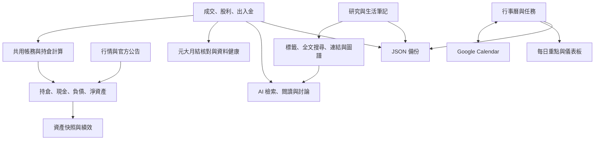

# Symbiosis 系統檢查與功能說明報告

> 本文為 **v26.10.4.4 修正前稽核**，保留原始發現與重現證據。八項問題與額外年度分母問題的第一批修改見 [10/04 修正報告](AUDIT_FIXES_2026-10-04.md)；後續另補修五個回歸／邊界問題，最新本機版本為 `v26.10.5.1`，詳見 [10/05 複查報告](AUDIT_RECHECK_2026-10-05.md)。剩餘公告與部署前提仍見 10/04 修正報告。下列舊測試數量、金鑰狀態及套件數量不代表修正後狀態；原重現腳本以缺陷存在為斷言，修正後請使用新增的回歸測試。

檢查日期：2026-10-04（Asia/Taipei）  
檢查版本：工作目錄 `APP_VERSION = v26.10.4.4`  
本次工作：程式審閱、測試、隔離重現、報告；沒有修正產品程式、修改正式資料或部署，因此維持產品版本號。

## 1. 檢查結論

Symbiosis 已具備相當完整的個人投資記帳、研究知識管理、行程與任務管理能力。核心帳務已有共用計算、帳號隔離、帳本版本控制、匯入檢查及備份預覽等保護，但部分進階績效仍保留另一套舊計算，跨模組的配股與融資、匯出與帳號切換也存在缺口。

本次確認 **8 項可重現的功能或計算問題**。其中 R04 是已實現損益曲線與一般資產回撤指標的口徑問題，畫面已有部分說明，不能將它說成未揭露的帳務錯誤；其餘包含股利認列、求解失敗處理、歷史估值、帳號隔離、配股融資連動及快照品質問題。另列出安全改善及功能限制，不混在缺陷數量裡。

最需要先處理的是：

1. **融資配股後，驗證與實際扣庫存使用不同股數，可能產生現金增加、持股與負債卻沒減少的帳本。**
2. **股利預告被歷史損益、年度復盤當成收入，與實際現金口徑不一致。**
3. **盤中快照缺乏收盤品質識別，歷史區間又使用目前價格估值，績效數字可能誤導。**
4. **知識庫分批匯出沒有固定起始帳號，途中切換帳號可能混入另一帳號正文。**

780 項主要測試全部通過，並不代表上述情境已受到保護。新增隔離案例正是用來指出既有測試的涵蓋缺口。沒有讀取正式私人帳務，因此無法判定使用者的真實資料是否已受影響。

## 2. 現在是一個怎麼樣的系統

這是一套以個人資料為中心的管理工作台：記錄投資行為，把研究與生活資料保存成筆記，再用行事曆與任務安排後續行動，AI 協助查找及整理。

| 模組 | 已實作的功能 | 實際用途 |
|---|---|---|
| 投資帳務與資產 | 買賣、現股／零股／ETF／融資、當沖配對、指定庫存沖抵、FIFO 成本、出入金、股利、持倉、現金、資產趨勢、歷史損益、年度復盤 | 重建元大單一券商帳戶的交易與資產狀態 |
| 對帳與風險 | 元大月結 PDF／圖片辨識與核對、資料健康中心、融資維持率與壓力試算、組合配置試算 | 發現帳差、檢查槓桿與配置；辨識結果仍須對照原單 |
| 投資研究 | 選股追蹤、賣出追蹤、情緒追蹤、產業地圖與關係、行情及相關資訊 | 保存投資理由、檢討決策、研究產業與標的 |
| 知識庫 KMS | 富文字與圖片筆記、階層標籤、搜尋、筆記連結、圖譜、垃圾桶、批次匯入、文字／Markdown 匯出 | 累積可查找、可串連的個人知識 |
| 行事曆與任務 | 個人／投資事件、跨日行程、任務與專案、每日重點、法說會關注、Google Calendar 同步與重複行程編輯 | 把研究、工作與生活安排成可追蹤行動 |
| AI 助理 | 對話、知識庫檢索與引用、較完整閱讀流程、聯網查證選項、互動偏好、對話摘要、額度與費用控管、筆記摘要與標籤建議 | 協助閱讀、搜尋與討論；仍受資料提供範圍及模型準確性限制 |
| 共用基礎 | 投資／KMS 雙 Firebase 專案登入、快取與同步、明暗主題、手機介面、錯誤及匯入提示、JSON 備份還原 | 跨頁共享資料並保護常見操作 |

目前帳務模型主要處理台股，外國行情可用於研究與追蹤；不能由「有外國報價」推定已具備外幣現金、多幣別交割與海外券商完整帳務。元大單一帳戶符合目前需求，無須為本次問題新增多券商支援。

### 資料如何運作



前端使用 React、TypeScript、Vite，資料主要保存於 Firebase；Netlify 承載前端與行情、Google、年度資料、AI 等後端函式。KMS 的搜尋索引及資料維護另有 Firebase Functions。

帳號資料以投資 Auth 的 UID 作為跨專案路徑識別；雙專案登入、KMS UID 對應及部署規則必須配合。這也解釋了為什麼長時間執行的讀寫工作要固定起始 session。

AI 後端確實能讀投資摘錄，但 `retrieveInvest()` 每個集合最多提供 20 筆且標示 `complete: false`；交易摘錄缺完整費稅、股利與出入金，不能替代完整帳本的持倉／淨資產計算。知識檢索同樣應以當輪來源及閱讀範圍判斷。

## 3. 核心公式與應有的解讀

| 項目 | 現在的主要公式／規則 | 解讀 |
|---|---|---|
| 成交價金 | 價格 × 股數，處理浮點誤差後捨去元以下 | 記帳價金與顯示市值不同；市值保留價格小數 |
| 現股買入收付 | 價金＋手續費 | 對現金是支出 |
| 融資買入收付 | 價金－融資借款＋手續費 | 僅自備款占用現金，借款另列負債 |
| 現股賣出收付 | 價金－手續費－交易稅 | 對現金是收入 |
| 融資賣出收付 | 價金－費稅－償還本金與利息 | 本金是減負債，利息才是損益成本 |
| 現金 | 入金－出金－買入收付＋賣出收付＋已確認現金股利 | 共用彙總以實際入帳日及查詢日期排除未生效股利 |
| 淨資產 | 持倉市值＋現金－融資負債 | 負債只扣一次；現金股利已在現金內，不能再加一次 |
| 已實現交易損益 | 賣出淨價金－沖抵批次成本－融資利息 | 預設 FIFO；現股可有指定批次、當沖另配對 |
| 未實現損益 | 市值－持倉成本－預估賣出費稅 | 預估處分費用不寫入帳本；此估值費率與電子成交折扣費率刻意不同 |
| 持倉報酬率 | 未實現損益 ÷ 成本；有融資時分母使用成本－借款 | 融資報酬率採自備款，不能直接和全額成本報酬比較 |
| 水位 | 持倉市值 ÷ 淨資產 | 有槓桿時可以高於 100%，不是自動代表資料錯誤 |
| 帳戶 XIRR | 期初淨值為負，入金為負、出金為正，期末淨值為正，求 NPV＝0 | 衡量投入資金的年化報酬；帳內買賣與股利不能再列為外部入金 |
| 自動近似 TWR | 每段因子＝（期末淨資產－區間淨入金）÷ 期初淨資產，各段相乘－1 | 採實際轉帳日收盤後資金流；出入金日缺快照時應中斷，估值品質仍有 R07 缺口 |
| 手動精確 TWR | 每次資金流前估值，分段報酬幾何串接 | 原有實作與資料保留，正常入口依偏好隱藏；不需要為本次修復重新開啟 |

**合理的不同口徑**：持倉報酬、已實現損益、帳戶 XIRR、TWR 衡量的對象不同，本來就可能不同。成交手續費使用 6 折估算，持倉估值按目前設定採未折扣的預估賣出費，也不是直接衝突。真正有問題的是同一個收入狀態、同一筆庫存或同一種年化算法在不同頁面不一致。

在目前模型中，現金按成交收付與帳務日期推算，沒有一套完整、獨立的逐日 T+2 待交割現金帳，因此顯示現金應理解為系統帳務餘額。融資利息另外使用交割日估算，不能因此推定現金已完全等同銀行當下可動用餘額。

XIRR 的 365 天年化口徑可參考 [Microsoft 官方 XIRR 說明](https://support.microsoft.com/en-us/excel/functions/xirr-function)。精確 TWR 對各次外部資金流估值的需求，可參考 [GIPS 計算方法說明](https://www.gipsstandards.org/standards/gips-standards-for-firms/gips-standards-handbook-for-firms/)；此處只是核對數學與估值前提，不宣稱本個人系統符合 GIPS 認證或報告要求。

## 4. 已重現的問題

P1：可能影響帳務、資料隔離或重要績效判讀，建議優先。P2：功能完整性、指標口徑或特殊條件問題。優先級不表示真實帳戶已發生事故。

| 編號 | 優先級 | 問題 | 重現結果 |
|---|---|---|---|
| R01 | P1 | 股利預告與實領日期未統一套用到報表 | 實領 2,000 元、預告 1,000 元，現金認列 2,000，歷史股利卻為 3,000；8 月除息、9 月付款的 2,000 元放到 8 月 |
| R02 | P2；失敗誤示為 0% 有重要影響 | XIRR 同時使用兩套算法，且年度求解失敗變成 0% | 共用算法為 10%，年度舊算法約 10.00718%；一年損失 99.95% 時舊算法無解，年度圖表卻顯示 0% |
| R03 | P1（用於評估歷史績效時） | 進階績效自訂區間使用目前價格估歷史起點與終點 | 歷史起價 100、終價 120，目前價 150；兩端都用 150，結果接近 0%，未反映期間 20% 價格變化 |
| R04 | P2，指標口徑問題 | MDD 使用從零開始的已實現累積損益 | 本金 100,000，獲利 1,000 後損失 500，顯示 50%；同一簡化資產曲線回撤約 0.495%。一直虧損的曲線還可能顯示 0% |
| R05 | P1 | KMS 分批匯出跟隨當下帳號 | 第 20 筆後 A 切到 B，第 21 筆成為「A 的標題＋B 的同 ID 正文」，仍下載成功 |
| R06 | P1 | 配股擴張持倉批次，卻未同步融資批次 | 1,000 股融資部位配 100 股後，預檢允許賣 1,100 股；計算卻略過賣出，保留 1,100 股與 60,000 元負債，現金已增加 50,000 元 |
| R07 | P1（績效估值品質） | 盤中成交價可形成快照，但缺收盤來源與估值時間識別 | 台北 10:00 報價通過快照檢查，快照帶 after-close 資金流基準，報酬模型也接受；若盤中 NAV 100,000、收盤 NAV 110,000，當日結果可從 10% 變成 0% |
| R08 | P2 | 進階績效年度統計漏掉只有股利、沒有賣出的年份 | 2025 年已確認領息 2,000 元但未出售，年度績效明細仍產生零列 |

### R01：股利收入的狀態與日期

位置：`src/pages/invest/HistoryPnL.tsx:90,131,169,186`；`src/pages/invest/YearReview.tsx:282,539,594,615`。對照正確排除預告的 `src/lib/calc.ts:833` 與股利頁。

歷史頁篩選只看搜尋和 `d.date`，沒有排除 announced。年度月表、熱圖、年度含息統計及持倉區間現金流也直接使用股利日期與金額。因此除了收入膨脹，跨月、跨年付款會產生分類偏差；尚未實領的預告也可能污染區間 XIRR。

建議提供共用「截至指定日期已確認、已生效的股利」轉換器，現金採 `cashPaymentDate`，股票採 `stockDistributionDate`；預告只作預告展示。若另外需要按除息日分析，應明確另列，不能混作已領現金收入。保留已存在、缺實際日期的舊資料相容策略，先提示再補正。

### R02：XIRR 算法漂移與缺值

位置：`src/pages/invest/YearReview.tsx:94,258,669`，對照 `src/lib/performanceReturns.ts:36`。

年度頁本地算法採 365.25 天、利率範圍 -99.9% 至 10,000%，共用算法採 365 天並處理更多無解／多解情況。正常區間差異通常很小，但不能讓同一種指標長期使用不同定義。更嚴重的是 `xirr != null ? xirr * 100 : 0` 把計算不到轉為零報酬。

建議所有帳戶型 XIRR 使用共用算法；缺資料、同日端點、無單一解、負淨值等應保留 null 與原因。歷史年度端點若不是年初／年末，也應顯示實際計算日期，而不是讓人以為涵蓋完整年度。

### R03：歷史端點缺實際估值

位置：`src/pages/invest/YearReview.tsx:429,462,475`。

持倉歷史快照只提供當時股數、成本與負債；兩端市值卻乘上現在 `savedPrices[code]`，沒取得當時市場價。本次無買賣、同一持股的案例仍接近 0%，證明不能當作期間市值績效。缺價改用成本也不會補出歷史市值。

建議區間績效優先使用對應日期的可信淨資產快照，或取得所有端點所需的歷史價格與有效負債。資料不足就顯示不可計算或明確標示成本模型，不能把它當作市場價 XIRR。

### R04：回撤分母與名稱

位置：`src/pages/invest/YearReview.tsx:112,443,522,563,956`。

目前畫面有「依已實現損益曲線計算」說明，因此這是已揭露一部分的模型限制。問題在於通常理解的 MDD 是資產／報酬曲線的峰值跌幅，而現在分母是累積獲利；沒有正峰值時直接為零，能出現超過 100% 或持續虧損仍 0% 的結果。

若保留現有算法，宜改稱「已實現累積獲利回落比例」並說明非正峰值時不可計算。若要真正的投資組合 MDD，應使用有品質標記、排除外部資金流影響的資產／報酬序列，並包含未實現損益。

### R05：知識庫匯出途中切換帳號

位置：`src/pages/kms/KMSExport.tsx:155`；`src/lib/kmsData.ts:138,171`。

實際匯出 handler、分批正文讀取器都沒有固定起始 session。後一批使用新的 `userDoc()` UID；備份還原保留筆記 ID，兩帳號有同 ID 是可成立的情境。即使沒有相同 ID，也可能讓後半部正文變空，而不是安全停止。

這是已登入使用者切換兩個系統帳號時的流程缺陷，本次沒有證明能越過 Firebase 權限去讀未登入帳號。建議讀正文前捕捉 session，每批前後與下載前確認仍有效，舊格式 fallback 讀取也使用同一個 session；帳號改變立即停止。

### R06：配股與融資帳本不一致

位置：`src/lib/calc.ts:497,536,670,717,750`；`src/lib/ledgerIntegrity.ts:15`；`src/lib/ledgerWrites.ts:38`。

配股增加 FIFO lot 的股數與 holdings，但 `MarginLedger` 只接收交易，不接收配股。驗證取的是增加後的庫存，實際融資賣出又依較少的融資股數判斷 unmatched；失敗後 silently continue，現金計算卻照樣加上賣出 total。

本次使用合法格式、人工本金／利息欄位的合成交易，執行實際寫入驗證純函式與計算，驗證接受後出現上述差異。沒有在正式環境 commit。

修復前需要依元大月結與配股／擔保品實際歸屬確認應列融資股數或獨立現股批次，再讓股數、成本、擔保市值與借款採相同事件時間軸。無論選哪種券商口徑，驗證允許的賣出都不能在計算時被默默略過。正式歷史資料應先唯讀核對，不直接自動調整。

### R07：快照沒有估值品質層級

位置：`src/lib/pricePolicy.ts:53`；`src/lib/snapshotPolicy.ts:4`；`src/lib/snapshot.ts:87,100,214`；`src/lib/performanceReturns.ts:110`。

已有的檢查能擋來源日期錯誤、參考價、失敗報價與部分舊快取，但「今日成交價」並不等於「今日收盤價」。背景時段允許 08:00–22:00，更新現價觸發更不受該時段限制，實際 `buildTodaySnapshot()` 接受本次 10:00 合成成交報價。

`after-close-v1` 原本是出入金基準標記，不能把它解讀為收盤價格證明。快照未保存可供績效層區分盤中、收盤已確認與手動未驗證估值的資訊；盤中或舊快照可以流入以日終估值為前提的計算。資產趨勢已標示「近似 TWR」，但這不能消除端點價格時間不同的誤差。

建議保留估值時間、報價來源與品質，區分盤中觀察值及已確認日終值；績效計算依品質限制或明確標示。維持使用者「實際轉帳日收盤後入金」假設，不回填到交易日，不把手動精確 TWR 變成必填。背景模式已有今日快照時不覆寫，更新現價則可覆寫；無人再開啟或刷新時，沒有保證盤中值最後會被收盤值取代。

### R08：只有股利的年份消失

位置：`src/pages/invest/YearReview.tsx:592,596`。

進階績效的年度清單只取 `realized` 賣出紀錄年份。股票持有多年但尚未賣出時，實際領息年份因此不出現在該表。本次執行實際 `loadPerformance()`，2025 年有買入與已確認股利但沒有賣出，`setYearStats()` 得到空陣列。

建議年度集合使用已實現交易與已生效現金股利年份的聯集；沒有出售的年度仍列現金股利，成本分母不足時報酬率顯示不適用，而非隱藏整年。

## 5. 安全與依賴狀況

### S01：前端 Fugle 用量金鑰

`src/lib/fugle.ts:5`、`src/pages/invest/AssetTrend.tsx:193` 仍使用 `VITE_FUGLE_API_KEY` 直接呼叫供應商。本次本機 production build 掃描確認有該值，證據只記錄布林，沒有保存或輸出金鑰。

登入與共用額度預約能保護正常程式流程，但公開前端 bundle 的用量金鑰仍可被取出，不能依靠前端預約保證第三方額度安全。建議行情與歷史行情改走驗證後端、快取及額度控制，完成後評估金鑰輪替。

**舊結論需更新**：目前 `src/lib/gemini.ts` 已呼叫驗證後端 AI API；本次沒有配置 `VITE_GEMINI_API_KEY`，建置也沒有該值。不能再沿用 10/01 報告把 Gemini 列為目前前端暴露項目。

### S02：保存登入密碼的保護範圍

`src/lib/accountStore.ts` 的 AES-GCM key 從程式內固定字串衍生。這能避免明文直接儲存，卻不構成獨立密碼保險箱；取得 localStorage 及程式邏輯的人可以解密。這是既有設計的保護限制，本次沒有讀取已存密碼、修改記住登入或清除帳號。

若之後處理，需同時考慮使用者便利性；可評估 Firebase 持續登入與系統／瀏覽器憑證機制，不必在本次稽核擅自取消既有偏好。

### S03：最新依賴公告

取得使用者明確授權後，已針對根目錄與 Firebase Functions 的獨立 lockfile 向 npm 官方 registry 執行唯讀 `npm audit --omit=dev --json`。

| 範圍 | moderate | high | critical | 套件項目總數 |
|---|---:|---:|---:|---:|
| 根目錄 | 37 | 8 | 1 | 46 |
| Firebase Functions | 8 | 3 | 0 | 11 |

這是受公告影響的套件／相依項目數，包含相依傳播與兩個 lockfile 的重疊，**不是 57 個已確認可利用的系統漏洞**。例如根目錄的 critical 為 `websocket-driver` 相依項目，尚未證明本系統存在可達的攻擊路徑。

- `xlsx@0.18.5`：有實際股票字典 Excel 匯入入口，優先處理。維護者指出舊版解析有 ReDoS，修正版本由官方 CDN 提供，不能只期待 npm 上舊 `xlsx` 執行一般 audit fix 即解決。見 [SheetJS 官方公告](https://cdn.sheetjs.com/advisories/CVE-2024-22363)。
- `@tiptap/core@3.29.2`：同時有屬性合併及 Markdown 解析公告，兩者修正版本分別為 3.30.4、3.30.5。固定 schema 與未使用相關 Markdown 路徑會影響可利用性；本次未證明本系統能觸發 XSS 或該 Markdown 攻擊。見 [屬性合併公告](https://github.com/ueberdosis/tiptap/security/advisories/GHSA-cp6q-959q-f8rh)及 [Markdown 解析公告](https://github.com/ueberdosis/tiptap/security/advisories/GHSA-j95f-988m-3j2f)。
- React Router、Firebase Admin、grpc 等也須依實際前端／後端使用方式審查；不能把所有伺服器框架公告直接套到 Vite SPA。

適合另做依賴維護批次，逐項處理相容性與可達性，本次沒有強制升級或修改 lockfile。

## 6. 功能缺口與運作限制

以下是目前能力邊界，不全部算作 BUG。

| 缺口／限制 | 現在的情況 | 改善方向 |
|---|---|---|
| 關閉系統後的收盤資產歷史 | 每日資產快照仍依賴前端開啟／更新現價；年度官方日程雖有後端排程，不等於資產快照有排程 | 若需要連續績效，建立後端日終快照及估值品質機制 |
| 媒體完整復原 | JSON 備份保存圖片／附件引用，明確 `binariesIncluded: false`；不含 Storage 二進位原檔 | 加入附件封存或獨立原檔備份，驗證還原後圖片可用 |
| 還原不是完整時間回溯 | 同 ID 覆蓋、缺 ID 新增；備份沒有的現有文件會保留 | 保留現有安全預覽，清楚區分合併還原與取代還原；取代模式需另設計 |
| 備份／還原整體原子性 | 多集合並行讀取不是同一時間點快照；跨兩專案、多批提交也不會全體回滾 | 保存一致性檢查與進度，必要時建立可恢復的作業紀錄 |
| 精確歷史市值與績效 | 部分區間沒有可信端點價或收盤標記 | 對資料品質及缺值採明確政策，先修 R03、R07 |
| 券商帳務自動取得 | 月結辨識與使用者確認是重要輸入，未具元大交易帳完整自動匯入／即時銀行餘額串接 | 優先強化人工對帳與來源追溯，避免把行情 SDK 視為券商帳務來源 |
| 外幣與海外投資帳務 | 有外國行情與研究標的，核心記帳仍以台股及單幣別為主 | 只有實際需要海外記帳時再擴充幣別、稅費及匯率模型 |
| AI 的完整帳本與對話復原 | 投資資料是有限摘錄；目前活躍對話與草稿保存於本機瀏覽器，JSON 備份白名單沒有這些本機資料 | 若需要跨裝置對話，另做明確保存與匯出流程；完整帳務問答應讀共用計算結果 |
| 正式規則與環境一致性 | 本次未驗證正式 Firebase／Netlify 設定、Google 真實授權、索引部署或遠端 CI | 另安排只讀配置核對、規則模擬器與授權後正式驗收 |
| 發布文件一致性 | 本機常數為 v26.10.4.4，README 的待部署版仍寫 v26.10.2.3 | 下次發布前對齊文件並確認實際站台版本；本次不推定正式版已同步 |

正常入口隱藏手動精確 TWR、移除資產趨勢自動績效說明卡，以及成功 KMS 搜尋只顯示搜尋總數，都符合目前明確介面偏好，**不列為功能遺漏**。

## 7. 本次驗證及證據

| 檢查 | 結果 |
|---|---|
| `npm test` 主要測試 | 780／780 通過，無跳過 |
| posttest 同步顯示 | 3／3 通過 |
| posttest UI 檢查 | 5／5 通過 |
| posttest 函式執行環境 | 6／6 通過 |
| `npm run lint` | 通過，零警告 |
| `npm run build` | 通過；部分 chunk 大於 500 kB，屬效能／分包提示 |
| 新隔離重現 | R01–R08 全部重現；合成資料，遠端 I/O 全數替換 |
| 新重現腳本 ESLint | 通過，零警告 |
| `npm run test:emulators` | 未執行測試：找不到 `java -version`，模擬器無法啟動 |
| 依賴公告 | 兩份 npm 官方稽核成功取得；受影響數如 S03 |
| 前端用量金鑰建置檢查 | Fugle 存在；Gemini 前端用量金鑰未配置、未出現在建置；未保存值 |
| 真實帳務、Google、付費 AI、手機逐頁操作 | 本次未操作或驗收 |

審閱涵蓋路由、投資核心計算與呼叫頁面、KMS／行事曆資料工具、匯入還原、AI 資料提供與權限流程、函式／規則原始碼與套件。這是源碼與本機稽核，不能宣稱所有 UI 流程、外部 API 或正式配置均驗收完成。

證據目錄：`docs/system-audit-2026-10-04/`。

- `reproduce.mjs`：執行實際純函式及擷取的實際頁面 callback，只替換 React 狀態接收端、帳號與遠端 I/O。
- `evidence.json`：合成案例輸入、實際輸出及判讀。
- `tests.log`、`lint.log`、`build.log`、`emulators.log`：本次驗證紀錄。
- `dependencies.json`、`function-dependencies.json`：兩份最新 npm 稽核原始結果。
- `key-exposure.json`：只有設定／建置出現與否，不含金鑰。

重現方式：

```text
node docs/system-audit-2026-10-04/reproduce.mjs
```

腳本中的斷言刻意確認「目前缺陷仍可重現」，不能把執行成功說成缺陷已修好。R03、R04、R07 的理論比較使用明確假設的合成價格／資產，不是使用者真實市場表現。

## 8. 建議修復與驗收順序

1. **帳務一致性**：R06 配股／融資事件統一、R01 股利狀態與日期共用；加上守恆檢查，禁止驗證接受但計算略過交易。
2. **資料隔離**：R05 固定 KMS 匯出 session，含每批讀取、舊正文 fallback、下載前與延遲下載時檢查。
3. **績效可信度**：R07 估值品質、R03 歷史端點、R02 唯一 XIRR；保留實際轉帳日收盤後入金及已保存手動 TWR。
4. **報表完整與名稱**：R08 股利年份聯集、R04 回撤定義及不適用情況。
5. **獨立安全維護**：Fugle 後端代理與依賴更新；登入保存方式若要調整，另和使用者偏好對齊。
6. **驗收與發布**：補齊 Java／Firebase 規則模擬器、跨頁同案例對比、真實月結唯讀對帳與必要的外部服務驗收。修復批次本機通過後，依 AGENTS.md 等待使用者明確同意再一併部署。

優先把「同一份資料在所有相關頁面得到一致、可解釋的結果」做完整，再增加新功能，會比繼續擴充介面更能提升這套系統的可靠性。
