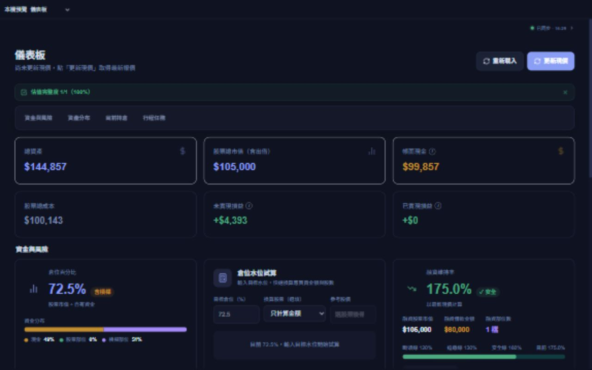

# 手機與 PC 介面對齊修正

本批版本 `v26.10.1.5`，完成本機修改及驗證，尚未部署。使用者提供同步狀態展開與收合的手機截圖，並明確要求 PC 也要注意對齊。

## 修改

- 同步狀態原本把圓點放在整個 details 元件旁邊，展開後對齊整塊內容的中間，造成圓點下沉。現在圓點、文字與箭頭在同一個 summary 列內，展開時間只出現在下方；收合與展開保持相同的右側位置。
- 共用 `DisclosureNote` 改用固定尺寸的 SVG 箭頭，移除瀏覽器原生 marker 的排列差異；保留原生 details 的鍵盤操作，並提供可見焦點樣式。
- 共用按鈕統一文字行高及中心對齊；獨立 Lucide 圖示與尚未指定排列的圖示按鈕也使用共用規則。既有明確指定的橫向、直向或特殊排列保留。
- `InfoHint` 圓圈內的 i 改用 flex 置中。
- 檢查時發現融資加碼試算在 320px 會把整頁撐寬。改為有明確標籤的等寬欄位：窄螢幕兩欄，較寬螢幕四欄；試算結果及移除操作放在欄位下方。明細表繼續在自己的區域水平捲動。計算與帳務邏輯未變。
- 將手機與 PC 的一致對齊要求記錄於 `AGENTS.md`，後續修改共用介面也要核對桌面及手機方向。

## 驗證

- 實際元件以隔離的記憶體資料及 Vite 本機預覽執行，沒有讀寫正式私人資料或使用券商額度。
- 同步列在 320×640、393×852、844×390、1280×800，展開前後圓點／文字／箭頭中心線偏差小於 0.01px，右側座標沒有移動。
- 11 個頁面各核對窄螢幕 320px、橫向尺寸 844px、PC 1280px 與 PC 1920px：儀表板、設定、年度復盤、配置試算、產業脈絡、知識庫匯出、知識圖譜、對帳、出入金、融資、除權息。可見圖示按鈕的圖示中心與按鈕中心沒有超過 1px 的偏差；PC 共用展開列也保持置中，沒有整頁超寬。
- 融資窄螢幕修正後 `main.scrollWidth === main.clientWidth`，四個輸入框等寬、高 44px；填入價格與股數後試算正常，新增及移除一筆也正常。
- 現有同步呈現測試 3／3 通過，維持同步異常及上次成功時間的語意。修改檔案 ESLint 無警告；TypeScript／正式建置及建置前 6 項函式執行環境檢查通過。
- 本機建置明確保留既有 `VITE_FUBON_SNAPSHOT_ENABLED=true`。登入記憶與報價額度規則未變更。

瀏覽器尺寸檢查不是實體 iPhone Safari 或實體 PC 環境的全面驗收；本批未重做各頁所有資料狀態或功能流程。

紀錄：`log/ui-alignment-sync-tests.txt`、`log/ui-alignment-lint.txt`、`log/ui-alignment-margin-lint.txt`、`log/ui-alignment-build.txt`、`ui-alignment-2026-10-01/browser-checks.json`、`ui-alignment-2026-10-01/final-sync-and-margin-checks.json`、`ui-alignment-2026-10-01/desktop-checks.json`。

展開後的本機手機預覽（示範資料）：

PC 1280px 本機儀表板預覽（示範資料）：

