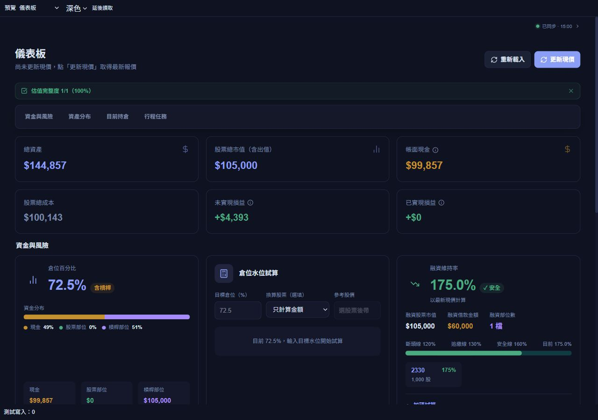
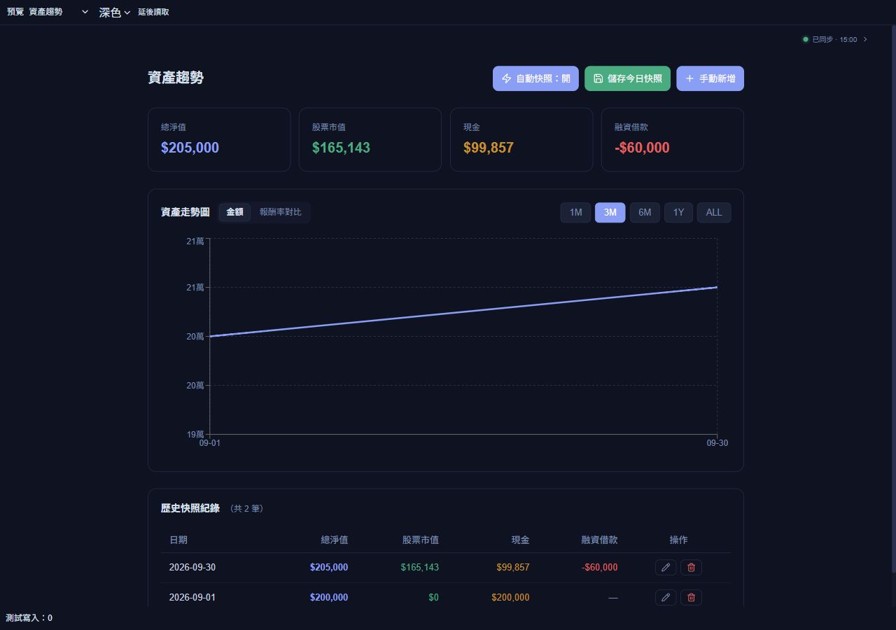
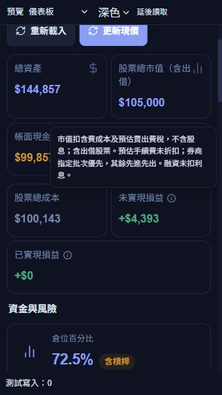

# 指定補充文字精簡：v26.10.2.3

依使用者指定的 N 編號完成本機修改，未部署 Netlify 或 Firebase。原始盤點及編號保留於 [完整清單](UI_COPY_INVENTORY_2026-10-02.md)。

## 移除 15 處

| 編號 | 位置 | 移除內容 |
|---|---|---|
| N001 | 儀表板 | 股票市值 ÷ 自有資金；無現價時加註「（以成本估算）」 |
| N002 | 儀表板 | 輸入目標水位，快速換算應買賣金額與股數 |
| N005 | 儀表板 | 未計入手續費、證交稅與成交滑價；融資帳戶以自有資金口徑計算。 |
| N035 | 資產趨勢 | 自動績效：預設收盤後入金 |
| N038 | 資產趨勢 | 比較起點：〔變動資料〕｜資料來源：Fugle MarketData｜近似 TWR |
| N039 | 資產趨勢 | 點「自動帶入」會從 Firebase 計算目前持倉市值與現金，並自動扣除融資借款 |
| N043 | 歷史損益 | 已實現損益與股利紀錄 |
| N066 | 融資管理 | 整戶融資維持率監控 · 加碼試算 |
| N073 | 組合水位試算 | 設定水位與占比，試算調整交易。 |
| N074 | 組合水位試算 | 先決定股票部位，再選擇這次允許的調整方式。 |
| N075 | 組合水位試算 | 可加入目前沒有持有、但想納入配置的股票。 |
| N094 | 觀點追蹤 | 記錄每次對股票的看多/看空，追蹤波段判斷勝率 |
| N102 | 賣出追蹤 | 觀察賣出後的股票後續走勢，反省操作決策 |
| N105 | 對帳核對 | 月中截圖暫核對，月底 PDF 完成月結；不修改交易。 |
| N118 | 設定與備份 | 匯入資料、匯出報表與完整備份 |

N035 連同自動績效說明卡片移除；N038 移除條件顯示區塊。其他移除項目刪除對應說明元素，避免留下空白容器。績效、出入金時間假設、試算結果及圖表功能仍沿用既有計算。

## 縮短 22 處

| 編號 | 位置 | 修改後文字 |
|---|---|---|
| N010 | 儀表板 | 成交日帳面現金，含未交割款；不等於銀行可提領餘額。交割款以元大查詢為準。 |
| N011 | 儀表板 | 市值扣含費成本及預估賣出費稅，不含股息；含出借股票。預估手續費未折扣；券商指定批次優先，其餘先進先出。融資未扣利息。 |
| N012 | 儀表板 | 賣出淨收入扣批次成本，與歷史損益一致；不同於 XIRR。 |
| N013 | 儀表板 | 更新現價、除權息、快照與法說會 |
| N014 | 儀表板 | 融資報酬率（自備款口徑）／現股報酬率 |
| N016 | 買賣紀錄 | 同股同日的現股整張自動沖抵，剩餘列庫存；零股、鉅額、融資及排除交易不配對，以券商認列為準。 |
| N031 | 股票持倉 | 市值扣含費成本及預估賣出費稅，不含股息；含出借股票。預估手續費未折扣；券商指定批次優先，其餘先進先出。融資未扣利息。 |
| N032 | 股票持倉 | 整體：未實現損益 ÷ 全額成本；融資個股：以自備款計算。 |
| N045 | 歷史損益 | 賣出淨收入扣成本；成本依當沖配對、券商指定或先進先出，含費稅與配股攤薄。部分當沖拆列，與 XIRR／TWR 不同。 |
| N047 | 歷史損益 | 已實現價差＋期間現金股利；報酬率以已實現成本為分母，無賣出顯示 —。股票股利反映於均價。 |
| N049 | 除權息 | 更新現價時查預告；未到期按現持股，到期按前日持股。確認實領才入帳。 |
| N056 | 年度復盤 | 摘要：帳戶績效依淨值與出入金計算。；展開：歷史端點需當日快照；今日無快照時採完整報價。起始淨值按日終，股利與買賣已含於淨值。 |
| N059 | 年度復盤 | 摘要：統計所選期間的交易。；展開：XIRR、回撤、勝率及持有天數均限所選期間。 |
| N078 | 組合水位試算 | 摘要：未含滑價；方案僅存此帳號／裝置。；展開：採參考價與系統費稅估算，交易前請核對券商；方案不含於 JSON 備份。 |
| N082 | 產業地圖－股票／題材 | 摘要：關係同步至脈絡圖。；展開：供應內容與刪除關係，請至「脈絡圖」管理。 |
| N087 | 產業地圖－脈絡圖 | 摘要：上游 → 下游；點股票追蹤。；展開：箭頭由供應商指向客戶；點連線刪除關係。顯示 〔層數〕 層，可調整。 |
| N092 | 選股追蹤 | 歷史資料更新中，限流時等待。 |
| N128 | 設定與備份 | 摘要：備份範圍與還原方式；展開：含全系統資料與附件引用，不含附件檔案；同 ID 覆蓋、不重複新增，還原前可確認差異。 |
| N148 | 知識圖譜 | 摘要：點標籤展開、筆記查看；可拖曳。；展開：子標籤展開筆記；移除根標籤只隱藏根節點。 |
| N150 | 知識圖譜 | 根標籤（隱藏）；子標籤（展開筆記）；浮動子標籤；筆記（查看） |
| N153 | 月曆／行程編輯 | .xlsx／.xls 必填：股票代號、股票名稱、法說會日期。日期：YYYY-MM-DD、YYYY/MM/DD 或 Excel 日期。合併匯入，不覆蓋。 |
| N166 | 法說會關注清單／設定 | 連結 Google 後，可手動同步未來半年行程。 |

## N020 常用交易稅說明

賣出個股顯示「個股 0.3%」；主動／被動股票 ETF 顯示「主動／被動ETF 0.1%」；買入顯示「買入免稅」。不再顯示債券 ETF 敘述；既有適用零稅率時顯示中性的「稅率 0%」，金額與日期規則仍使用原本的 securityTaxRate，沒有改寫交易費稅、當沖或成交紀錄。

## 驗證

- 38 個指定項目核對完成；15 處移除的 JSX 說明不再存在。原始 168 個說明位置剩餘 153 個，保留原 N 編號供後續指定。
- TypeScript、20 個受影響程式檔案的 ESLint、前端建置通過；建置沿用 VITE_FUBON_SNAPSHOT_ENABLED=true，6 項函式 runtime 檢查通過。
- UI、同步、當沖呈現、交易清單及績效回歸等針對性測試共 54 項通過。
- 18 個頁面 × 桌機 1280×900、直向 393×852、窄手機 320×568、橫向 844×390，共 72 組隔離渲染檢查：無整頁或主內容水平溢出，無空白頁或空白說明 section。
- 窄手機的未實現損益提示框左右在視窗內（72–312px）；Escape 可關閉。法說會 Excel 匯入說明可在 320px 視窗閱讀。
- 隔離交易表單以 00981A、0050、2330 核對主動 ETF、被動 ETF、個股的賣出提示，另核對買入免稅；沒有送出交易，測試寫入為 0。
- 本批是呈現文字與隔離預覽調整，沒有新增套件、API 呼叫、排程或持續動畫。既有大型建置 chunk 警告仍存在。

量測：[layout-metrics.json](ui-copy-selected-2026-10-02/layout-metrics.json)。

## 本機示範預覽

