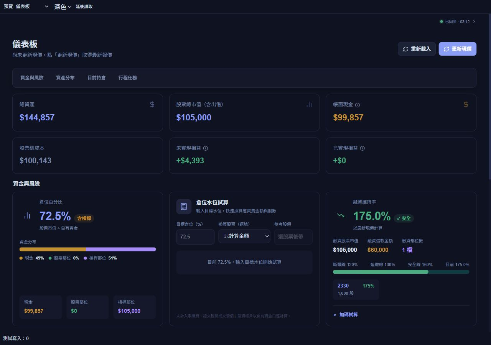
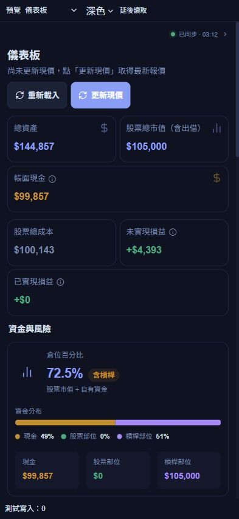
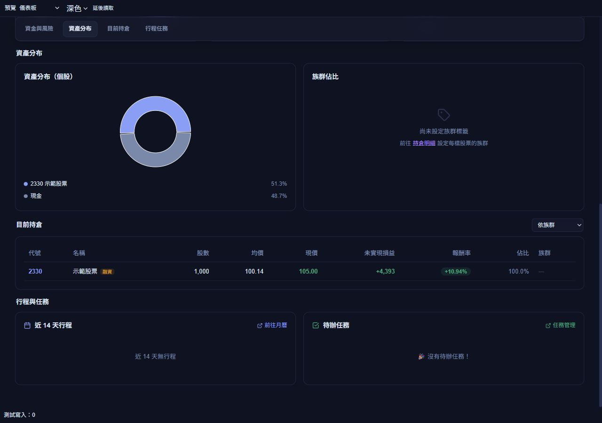
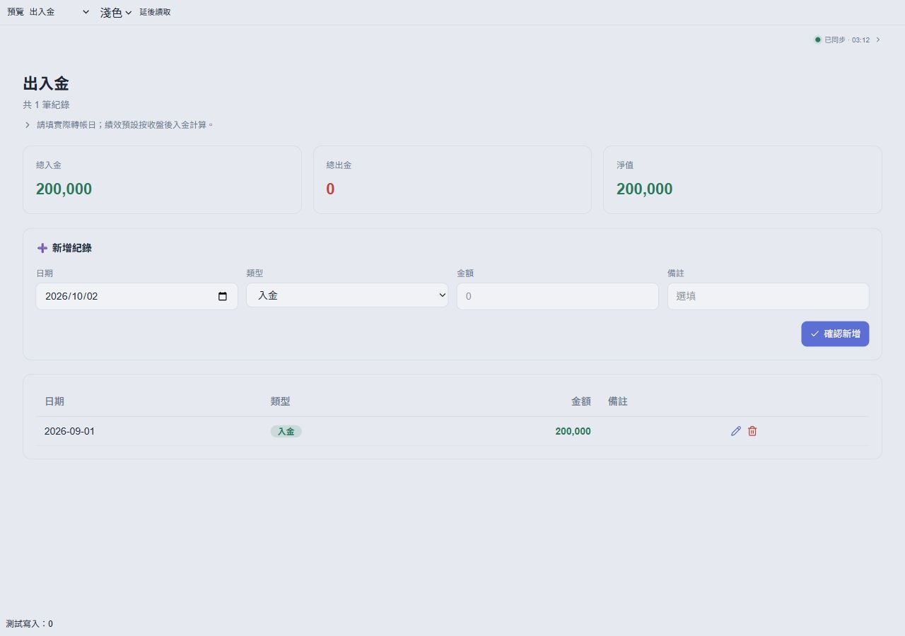

# 恢復原版配色：v26.10.2.2

依使用者最新偏好，系統恢復原版色票，不再採用莫蘭迪或其他新配色。本批僅完成本機修改與驗證，未部署 Netlify 或 Firebase。

## 修改內容

- 深色主色恢復 `#8b9ef5`、淺色主色恢復 `#5b6fd4`；背景、卡片、邊框、文字及正向／危險／警示色均回到原版。
- 共用按鈕直接使用原版語意色，實心按鈕恢復白色文字；維持一致的圖示對齊、圓角、間距與點擊尺寸。
- 資產分布圖恢復既有的依序色票、現金灰色及原有圖例；資金分布恢復現金警示色、股票正向色、槓桿紫色。沒有修改資料或計算。
- 保留前批的 PC／手機對齊、緊湊排版、表格數字對齊、欄位提示、系統確認視窗與刷新時保留資料的改善。
- 將維持原版色票的偏好加入專案指示，避免後續樣式整理再次更換配色。

## 驗證

- TypeScript、受影響的 UI／儀表板 ESLint、前端建置通過；建置沿用 `VITE_FUBON_SNAPSHOT_ENABLED=true`，函式 runtime 6 項通過。
- UI 決策／欄位映射／金額格式與同步呈現的針對性測試共 8 項通過。前批新色票的對比門檻測試隨需求撤回，其餘功能測試保留；沒有為原版配色另創對比保證。
- 桌機 1280×900、手機直向 393×852、窄手機 320×568、橫向 844×390：頁面沒有水平溢出；同步狀態展開前後右邊界移動 0px。
- 實際讀取按鈕樣式為原版 `rgb(139, 158, 245)`；資產分布的股票與現金扇區分別為原版主色及灰色。淺色預覽確認原版主色 `#5b6fd4` 與背景 `#f0f2f5`。
- 此批沒有新增套件、API 呼叫、排程或持續執行的動畫。既有大型建置 chunk 警告仍在；本機示範資料不代表正式站網路延遲。

量測：[layout-metrics.json](ui-original-colors-2026-10-02/layout-metrics.json)。

## 本機示範預覽

