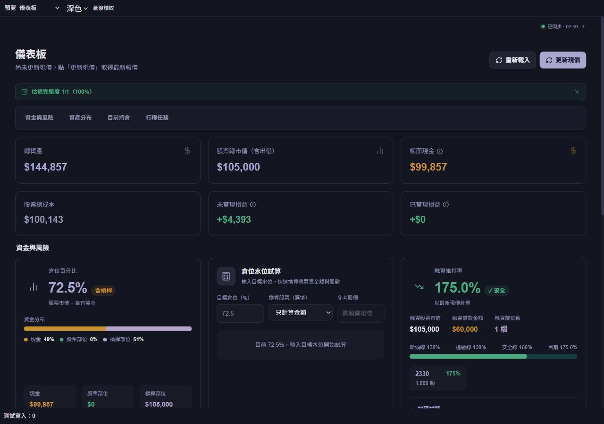
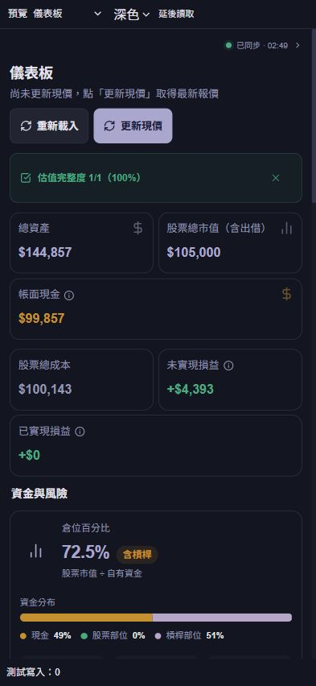
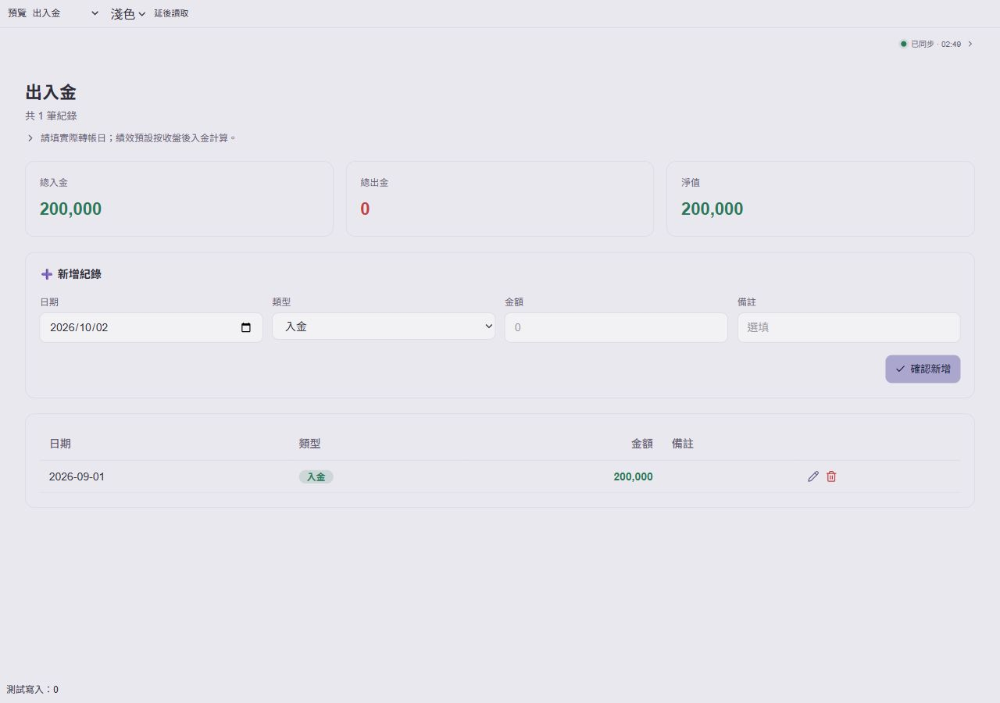
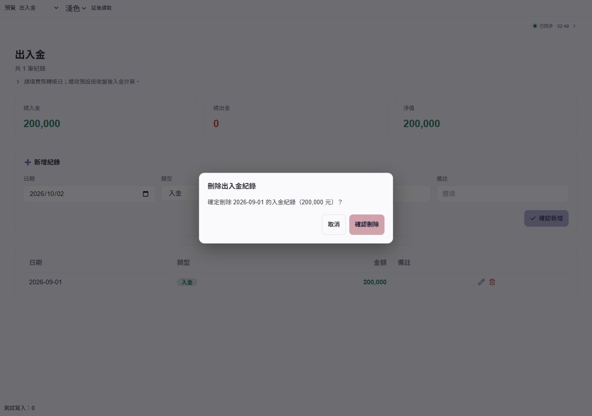

# UI 優化：v26.10.2.1

後續 `v26.10.2.2` 已依使用者決定恢復原版配色；以下莫蘭迪色票與配色預覽僅保留為本批歷史紀錄，其他 UI 整理仍保留。目前配色與驗證請見 [恢復原版配色](UI_ORIGINAL_COLORS_2026-10-02.md)。

本批為本機待部署版本，包含 v26.10.1.5 的介面對齊修正。未執行 Netlify 或 Firebase 部署。

## 使用者偏好

手機與 PC 都要整齊；字體不要全面放大、減少留白，說明圖示不大於旁邊文字。主色採柔和、帶灰調的莫蘭迪色，避免偏藍、老氣或沉重的按鈕。損益及風險保留清楚的語意色。

## 八項修改

| 項目 | 本批修改 |
| --- | --- |
| 1. 元件一致性 | 合併重複的標準卡片、輸入框、標籤和按鈕樣式；統一按鈕圖示對齊、圓角與間距，修正儀表板前三張卡片邊框意外變亮。刻意不同的版型保留。 |
| 2. 配色與對比 | 主按鈕為灰調薰衣草紫 #aaa6ce；操作色搭配鼠尾草綠 #a5bfb3、乾燥玫瑰 #d0a3ac、暖米色 #d0bd99。以深色按鈕文字保持閱讀對比，深淺色次要文字也改善。財務漲跌色不改變含義。 |
| 3. 密度與排版 | 標準按鈕文字 13px，PC 卡片內距 18px、手機維持 12px；整理頁首間距。手機輸入框維持既有 16px 防止 iOS 自動放大，點擊區也保留。沒有全面放大文字。 |
| 4. 財務表格 | 持倉、儀表板持倉、交易、股利、出入金、歷史損益、融資及水位試算的金額／股數／比例標題與資料靠右，表格使用等寬數字。共用損益金額格式補上負號，不只靠紅色判斷虧損；資料、價格精度與計算不變。 |
| 5. 說明圖示與鍵盤 | InfoHint 改成原生按鈕，圖示繼承文字大小，透明點擊範圍較寬；可鍵盤開啟、Escape 關閉，提示依視窗空間決定位置且不超出左右邊界。族群設定也可用鍵盤操作。 |
| 6. 欄位錯誤 | 出入金／除權息使用原本的帳務驗證器，在對應欄位旁顯示錯誤並帶到第一個可修改欄位；補上標籤連結及 aria-invalid／aria-describedby。交易表單既有必填提示補上焦點定位。 |
| 7. 確認視窗 | 投資、KMS、行事曆及共用元件的原生 confirm／alert 換成一致的系統視窗，刪除顯示日期／股票／金額／標題等上下文；預設焦點在取消，Escape 取消且焦點返回。重複點擊不排隊；換頁、元件卸載或登入帳號變更均取消未完成決策。 |
| 8. 刷新體感 | 儀表板、持倉、融資、歷史損益、年度復盤、水位試算、追蹤、資產趨勢、情緒追蹤、KMS 匯出／圖譜／垃圾桶／標籤等保留已成功載入的資料；首次載入可用靜態佔位，刷新只顯示簡短提示。資產趨勢讀取失敗保留先前資料；匯出讀取失敗有重試。 |

## 效率與範圍

- 沒有新增報價 API、背景排程或定時輪詢，沿用既有快取及券商報價額度控制。
- 提示框僅在顯示時註冊事件；滾動時關閉，不做每幀定位。欄位焦點只在無效送出時排一次 animation frame。
- 確認狀態使用獨立 store，只有 DialogHost 訂閱，避免透過整頁 context 重繪。載入佔位沒有閃動動畫，也沒有新增背景模糊特效。
- 登入記憶、交易／股利計算、隱藏的手動精確 TWR 和已存資料保持原有規則。已存在的大型 HEIC 等建置 chunk 警告仍在，這批沒有加入新套件。
- 本機預覽使用隔離記憶體資料，不能代表正式站的真實網路延遲或所有裝置的 FPS。

## 驗證

- 完整既有測試 707 項通過；同步呈現 3 項、UI 決策／欄位映射／配色／負號 6 項、函式 runtime 6 項均通過。
- 受影響的重試、報價、帳務整合及 UI 測試 108 項通過；測試 harness 適配新的共用樣式及非同步確認依賴。
- TypeScript、前端建置及修改涉及的 UI／頁面 ESLint 通過。建置保留 VITE_FUBON_SNAPSHOT_ENABLED=true。
- 14 個頁面 × 1280×900 PC／393×852 直向／320×568 窄手機／844×390 橫向，以及 14 個淺色 PC 頁面，共 70 組本機渲染檢查：無頁面水平溢出、空白頁或大於文字的說明圖示。
- 四種尺寸同步狀態：圓點、文字與箭頭中心一致，展開後右邊界移動 0px。
- 無效股利未寫入，焦點到股票代號或缺少的實際入帳日期。取消出入金刪除後保留紀錄、測試寫入 0，焦點回到刪除按鈕。
- 模擬延後資料讀取：刷新保留六張 KPI、沒有初次載入佔位；完成後移除更新提示。
- 財務欄位 computed style 確認靠右；320px 的提示框完整文字可閱讀且左右在視窗內。

排版量測：[layout-metrics.json](ui-polish-2026-10-02/layout-metrics.json)。

## 預覽（隔離示範資料）

